# IriSight — WRO Future Engineers 2026

*Repository of Team IriSight competing in the WRO 2026 International Final, Future Engineers category.*

<div align="center">

<!-- Add International Round project banner here -->

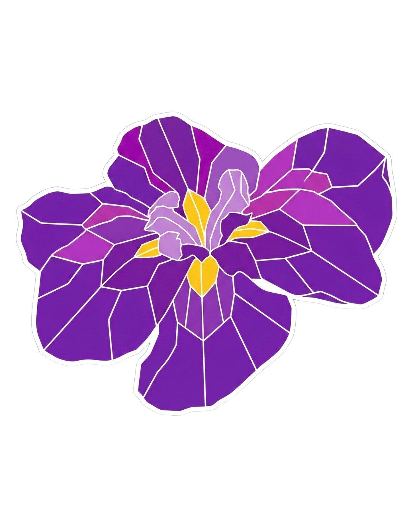

<p><em>"Break, Fix, Repeat"</em></p>
</div>

## Quick Link - Explore the project

<table width="100%">
  <tr>
    <td width="33.33%" align="center" valign="top">
      <a href="src/"><strong>💻 Code</strong></a><br>
      <sub>Jetson and ESP32 control code</sub>
    </td>
    <td width="33.33%" align="center" valign="top">
      <a href="schemes/"><strong>🔌 Schematics</strong></a><br>
      <sub>Wiring, power, and electronics</sub>
    </td>
    <td width="33.33%" align="center" valign="top">
      <a href="models/"><strong>🧩 CAD models &amp; Mechanics</strong></a><br>
      <sub>Mechanical design and printable files</sub>
    </td>
  </tr>
  <tr>
    <td width="33.33%" align="center" valign="top">
      <a href="v-photos/"><strong>🚗 Vehicle Photos</strong></a><br>
      <sub>Required views of the final robot</sub>
    </td>
    <td width="33.33%" align="center" valign="top">
      <a href="t-photos/"><strong>👥 Team Photos</strong></a><br>
      <sub>Official and informal team photos</sub>
    </td>
    <td width="33.33%" align="center" valign="top">
      <a href="video/"><strong>🎥 Videos</strong></a><br>
      <sub>Autonomous challenge demonstrations</sub>
    </td>
  </tr>
</table>

## Contents

- [Repository Structure](#repository-structure)
- [Meet the Team](#meet-the-team)
- [Meet the Vehicle](#meet-the-vehicle)
  - [Final Vehicle Gallery](#final-vehicle-gallery)
  - [Key Specifications](#key-specifications)
- [Performance Videos](#performance-videos)
- [How IriSight Works](#how-irisight-works)
  - [System Architecture](#system-architecture)
- [Our Engineering Journey](#our-engineering-journey)
  - [Engineering Design and Iterations](#engineering-design-and-iterations)
  - [Final Engineering Blueprints](#final-engineering-blueprints)
- [Mobility and Mechanical Design](#mobility-and-mechanical-design)
  - [Chassis and Component Mounting](#chassis-and-component-mounting)
  - [Drive System](#drive-system)
  - [Steering System](#steering-system)
  - [Mechanical Iterations](#mechanical-iterations)
- [Power and Sensor Architecture](#power-and-sensor-architecture)
  - [Power Architecture](#power-architecture)
  - [Component and Interface Map](#component-and-interface-map)
  - [Sensor Placement and Calibration](#sensor-placement-and-calibration)
- [Software and Challenge Strategy](#software-and-challenge-strategy)
  - [Software Architecture and Communication](#software-architecture-and-communication)
  - [AI Model and Computer Vision Pipeline](#ai-model-and-computer-vision-pipeline)
  - [Navigation and Control Strategy](#navigation-and-control-strategy)
  - [Challenge Implementation](#challenge-implementation)
  - [Test Results](#test-results)
- [System Integration, Testing, and Risk](#system-integration-testing-and-risk)
  - [Subsystem Interaction](#subsystem-interaction)
  - [Final Regression Results](#final-regression-results)
  - [Key Engineering Decisions](#key-engineering-decisions)
  - [Risk Register](#risk-register)
- [Reproducing IriSight](#reproducing-irisight)
  - [Required Files and Tools](#required-files-and-tools)
  - [Mechanical Assembly](#mechanical-assembly)
  - [Wiring and Power-On](#wiring-and-power-on)
  - [Software Installation](#software-installation)
  - [Calibration](#calibration)
  - [Starting an Autonomous Run](#starting-an-autonomous-run)
  - [Pre-flight and Acceptance Test](#pre-flight-and-acceptance-test)
- [Current Limitations and Future Improvements](#current-limitations-and-future-improvements)
- [National Round Archive](#national-round-archive)
- [License](#license)

---

## Repository Structure

This repository is organized as follows:

```
📦 WRO_IriSight
├── 📁 matlab_simulink          # MATLAB/Simulink models and steering simulations
│
├── 📁 media                    # Project banner and general media assets
│
├── 📁 models                   # International Round CAD models and mechanical designs
│
├── 📁 other                    # Additional documentation and archived projects
│   └── 📁 legacy_national      # Complete National Round project archive
│       ├── 📄 README.md
│       ├── 📁 media
│       ├── 📁 models
│       ├── 📁 schemes
│       ├── 📁 src
│       ├── 📁 t-photos
│       ├── 📁 v-photos
│       └── 📁 video
│
├── 📁 schemes                  # Electrical schematics, wiring, and power documentation
│
├── 📁 src                      # Main source code for the International robot
│   ├── 📁 ai_model             # AI model and computer vision
│   ├── 📁 main_controller      # Main autonomous control software
│   ├── 📁 microcontroller      # ESP32 firmware and actuator control
│   ├── 📁 obstacle_advoidance  # Obstacle Avoidance Challenge implementation
│   └── 📁 open_challenge       # Open Challenge implementation
│
├── 📁 t-photos                 # Team photographs
│
├── 📁 v-photos                 # Vehicle photographs and documentation
│
├── 📁 video                    # Autonomous driving and challenge demonstration videos
│
├── 📄 .gitignore               # Git ignore configuration
├── 📄 LICENSE.txt              # MIT License
└── 📄 README.md                # Main project documentation
```

## Meet the team

<div align="center">
  
  <p><em>Team Photo - From left to right: Nita, Panha (Coach), and Muyleang.</em></p>
</div>

<table style="border: 1px solid #ccc; width: 100%; border-collapse: collapse; margin-bottom: 20px;">
  <tr>
    <td width="30%" align="center" valign="top" style="padding: 15px; border-right: 1px solid #ccc;">
      <strong>Ponlork Ponita</strong><br><br>
      
    </td>
    <td width="70%" valign="top" style="padding: 15px;">
      <strong>Role:</strong> 3D Design & Mechanical Engineer (CAD, Mounts, Blueprints)<br><br>
      <strong>Origin:</strong> Phnom Penh<br><br>
      <strong>Email:</strong> 2024352ponlork@aupp.edu.kh<br><br>
      <strong>Bio:</strong> A junior student at the American University of Phnom Penh (AUPP), she led the CAD design of the team's 3D-printed structural parts. Including the Jetson & Battery Container, the rear Motor Mount, and the RealSense Camera Mount. She carried each component through multiple print-and-test-fit iterations to achieve a LEGO-compatible, chassis-mounted final version, meticulously documenting dimensions and material properties in her blueprint sheets.
    </td>
  </tr>
</table>

<table style="border: 1px solid #ccc; width: 100%; border-collapse: collapse; margin-bottom: 20px;">
  <tr>
    <td width="70%" valign="top" style="padding: 15px; border-right: 1px solid #ccc;">
      <strong>Role:</strong> Electrical & Sensor Engineer (Wiring, Power, Sensors)<br><br>
      <strong>Origin:</strong> Phnom Penh<br><br>
      <strong>Email:</strong> 2024355taing@aupp.edu.kh<br><br>
      <strong>Bio:</strong> Serving as the hardware integration lead, she managed the vehicle's electrical infrastructure. She mapped the custom wiring schematics, engineered a stable power distribution system for the compute and motor payloads, and rigorously tested and calibrated sensor placements to guarantee accurate real-time data collection for the system's navigation stack.
    </td>
    <td width="30%" align="center" valign="top" style="padding: 15px;">
      <strong>Taing Muyleang</strong><br><br>
      
    </td>
  </tr>
</table>

<table style="border: 1px solid #ccc; width: 100%; border-collapse: collapse; margin-bottom: 20px;">
  <tr>
    <td width="30%" align="center" valign="top" style="padding: 15px; border-right: 1px solid #ccc;">
      <strong>Chamroeun Vireakpanha</strong><br><br>
      
    </td>
    <td width="70%" valign="top" style="padding: 15px;">
      <strong>Role:</strong> Team Coach<br><br>
      <strong>Origin:</strong> Battambang<br><br>
      <strong>Email:</strong> 2024033chamroeun@aupp.edu.kh<br><br>
      <strong>Bio:</strong> A senior student majored in Information and Communication Technology at the American University of Phnom Penh, with experience in 3D modeling, CAD, vehicle design, and autonomous-vehicle software. In the previous season, he helped design and optimize the robot's custom parts and mechanical structure while also contributing to software, planning, coordination, and technical documentation. As IriSight's coach for the 2026 season, he uses that hands-on competition experience to guide the team through mechanical design, software development, system integration, testing, and documentation while keeping the engineering work student-led.
    </td>
  </tr>
</table>


## Meet the Vehicle

<div>
  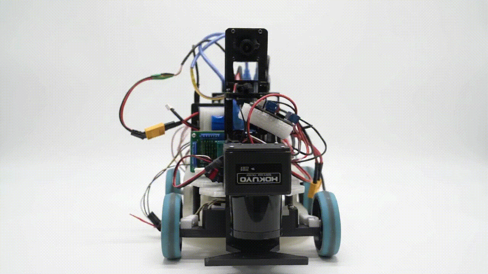
  <p><em>Vehicle 360º view (GIF)</em></p>
</div>

### Final Vehicle Gallery

|  | 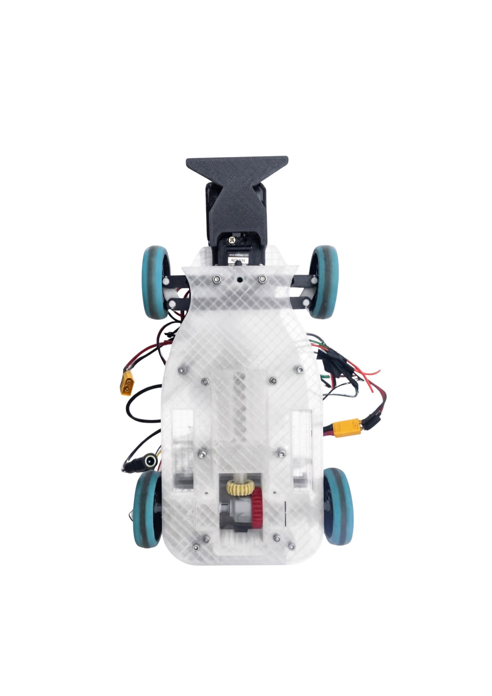 |
| :---: | :---: |
| **Top** | **Bottom** |

|  |  |
| :---: | :---: |
| **Left** | **Right** |

|  |  |
| :---: | :---: |
| **Front** | **Back** |

### Key Specifications

Measurements include the installed sensors and batteries.

| Property | Current robot | Rule limit | Remaining margin |
| --- | ---: | ---: | ---: |
| Length | 298 mm | 300 mm | 2 mm |
| Width | 159 mm | 200 mm | 41 mm |
| Height | 223 mm | 300 mm | 77 mm |
| Mass | 1.28 kg | 1.50 kg | 0.22 kg |

| Subsystem | Current configuration |
| --- | --- |
| Main computer | NVIDIA Jetson Orin Nano running JetPack SDK in 15 W mode |
| Microcontroller | ESP32-based controller board |
| Drive | One JGB37-520 geared DC motor, 12 V, 100 RPM |
| Rear transmission | JGB-to-LEGO coupler and one LEGO mechanical differential |
| Steering | MG996R servo and custom close-Ackermann front linkage |
| Wheels | Four LEGO 56 × 14 Technic wheels, part `39367pb01` |
| Primary ranging | Hokuyo UST-30LX 2D LiDAR |
| Vision | 1 MP Yahboom/Raspbot USB camera on a DMS-MG90-A 270° pan servo |
| Orientation | Adafruit BNO055 IMU |
| Rear distance | One rear-facing VL53L0X ToF sensor |
| Structure | Custom PLA chassis, electronics deck and subsystem mounts |
| Batteries | Two TCB 3S 1100 mAh 25C LiPo packs |

The 2 mm length margin is the most restrictive packaging constraint and drove
the cantilevered LiDAR mount design.

## National-to-International redesign

The International vehicle is a ground-up mechanical rebuild, not a cosmetic
revision of the National platform.

| Area | National robot | International robot | Engineering reason |
| --- | --- | --- | --- |
| Steering | Parallel front steering | Printed close-Ackermann linkage | Reduce tire scrub and improve the relationship between inner- and outer-wheel paths |
| Main ranging sensor | Intel RealSense D455 | Hokuyo UST-30LX 2D LiDAR | The D455 produced noisy detection on its left side; the LiDAR provides direct planar range data |
| Camera role | Depth and color perception centered on the RealSense | Small 1 MP camera for pillar classification and planned stationary mapping | Separates geometric ranging from color recognition and reduces camera dependence while driving |
| Rear motor | JGA25-370 (team recollection) | JGB37-520, 12 V, 100 RPM | More suitable drivetrain for the rebuilt platform |
| Rear transmission | Non-LEGO wheels with steel axles/gears from another kit | Custom coupler, LEGO differential and LEGO axles | Creates a replaceable, documented and mechanically integrated drivetrain |
| Wheels | Mixed front and rear wheel systems | Four matching LEGO `39367pb01` wheels | Removes the previous sticky rear-wheel behavior and standardizes wheel geometry |
| Structure | Primarily LEGO with several printed equipment mounts | Custom PLA lower chassis, six standoffs and an integrated electronics deck | Provides rigid alignment for the heavier sensor and computer package |
| Documentation | National files distributed across root subsystems | Self-contained archive under `other/legacy_national/` | Prevents historical code and hardware from being mistaken for the current robot |

The former rear wheels could remain stuck on the field below approximately
100/255 motor command even while the motor and wheels rotated normally when
the rear was lifted. Together with the sensor noise, parallel-steering limits
and shortage of reliable LEGO spares, this led the team to rebuild the robot
instead of extending the old frame.

## Performance Videos

| Challenge / Test | Video |
|---|---|
| Open Challenge | [Watch on YouTube](https://youtu.be/8kb7vfMW33Q) |
| Obstacle Avoidance Challenge | [Watch on YouTube](https://youtu.be/Gv9RtIQvm2Q) |

---

## How IriSight Works

IriSight is a small autonomous car built around a Jetson Orin Nano. It sees the track with a Hokuyo LiDAR (distances to walls) and a USB camera (red and green pillars), and it knows which way it is facing from a BNO055 IMU. The Jetson combines all of that in a state machine, decides on a steering angle and a speed, and sends them to an ESP32 over USB serial. The ESP32 drives the rear motor and the steering servo.

We keep perception and control separate on purpose. YOLO only tells the controller what color a pillar is and roughly where it is. It never steers the car directly. The LiDAR and IMU do the actual driving, so a missed camera detection can't make the robot do something wild.

### System Architecture

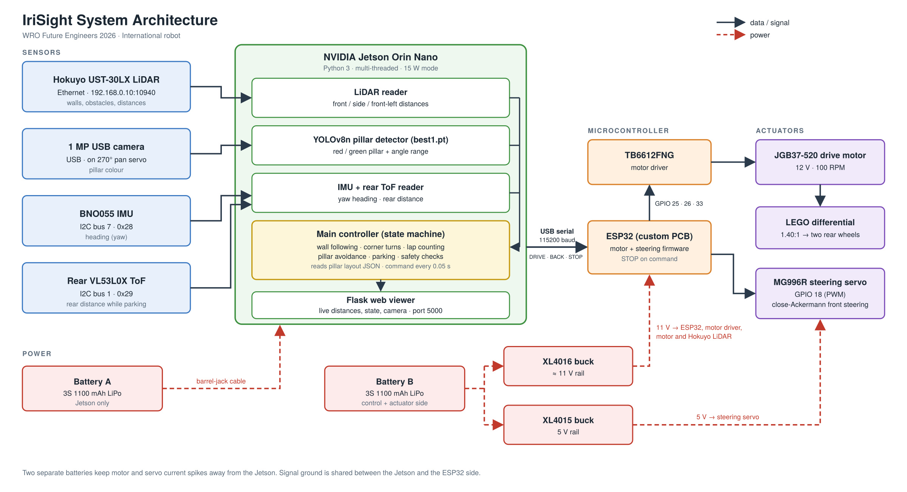

| Subsystem | Description |
|---|---|
| Power | Two 3S 1100 mAh LiPo packs. Battery A powers only the Jetson. Battery B powers the ESP32, motor driver and LiDAR through an XL4016 rail (about 11 V), and the MG996R steering servo through an XL4015 (5 V). Keeping them separate stops motor and servo current spikes from resetting the Jetson. |
| Perception | Hokuyo UST-30LX LiDAR (walls, obstacles, distances), BNO055 IMU (yaw), 1 MP USB camera with YOLOv8n (pillar color), rear VL53L0X (distance while parking). |
| Processing | Jetson Orin Nano in 15 W mode, running Python 3 with threads for LiDAR, YOLO, the main controller and the Flask web viewer. |
| Decision | A state machine for wall following, corner detection, pillar avoidance, lap counting and parking. It uses LiDAR geometry, IMU heading and the pillar layout JSON. |
| Actuation | ESP32 turns `DRIVE`, `BACK` and `STOP` commands into servo position and motor PWM through the TB6612FNG. The motor drives the rear wheels through a LEGO differential, and an MG996R steers the front wheels through the close-Ackermann linkage. |
| Communication | Jetson to ESP32: USB serial, 115200 baud. LiDAR: Ethernet. IMU and rear ToF: I2C. Camera: USB. A command is sent every 0.05 s. |
| Safety | Emergency-stop checks on every LiDAR sector, a stale-scan timeout, per-maneuver timeouts, steering and heading error clamping, and `STOP` on any fault or Ctrl+C. Known gap: the ESP32 has no command timeout yet (see Limitations). |

---

## Our Engineering Journey

[Describe the development process for the International Round, including the problems encountered and solutions implemented.]

### Engineering Design and Iterations

| Version / Date | Problem or Goal | Design Change | Testing / Evidence | Result |
|---|---|---|---|---|
| [Version 1] | [Describe problem] | [Describe change] | [Add evidence] | [Describe result] |
| [Version 2] | [Describe problem] | [Describe change] | [Add evidence] | [Describe result] |
| [Version 3] | [Describe problem] | [Describe change] | [Add evidence] | [Describe result] |

### Final Engineering Blueprints

[Add descriptions of the finalized mechanical components and their engineering specifications.]

<!-- Add engineering blueprint images here -->


**Detailed documentation:** [Add link to models documentation.]

---

## Mobility and Mechanical Design

### Rear Drivetrain Module

One JGB37-520 motor drives both rear wheels through a mechanical LEGO
differential. A custom **JGB-to-LEGO Axle Coupler** converts the motor's
D-shaped shaft to the LEGO drivetrain input. The **Integrated
Motor–Differential Mount V2** holds the motor, coupler and differential in one
aligned structure.

The first approach used separate motor and differential supports. Testing
showed vibration at the coupler, so the mounts were integrated. A later
refinement added room for another Technic bush after the right rear axle could
slide outward at high speed. Turning one unpowered rear wheel by hand makes the
other turn in the opposite direction, confirming differential action.

<div align="center">
  
</div>

The 20-tooth motor-input gear drives the differential's 28-tooth ring gear,
adding a `28/20 = 1.40:1` reduction after the 100 RPM motor gearbox. The
estimated no-load wheel speed is therefore 71.43 RPM. With the nominal 56 mm
wheels, this corresponds to approximately `0.209 m/s`. Ideally, the same gear
pair multiplies motor-output torque by 1.40 before drivetrain losses. This
trades theoretical speed for additional wheel torque; the complete derivation
and its limitations are in the [mechanical documentation](models/#drivetrain-speed-and-torque-reasoning).

### Chassis and Component Mounting

The **Main Chassis Plate V2** carries the drivetrain and steering. Six 42 mm
**Electronics Deck Standoffs V2** connect it to the one-piece **Integrated
Electronics Mounting Deck V1**. The upper deck holds two batteries, supports
the Jetson, and provides reusable holes for sensors and test electronics.

The LiDAR is mounted at the front with a dedicated deck mount and impact guard.
The guard has already protected the sensor during contact without obstructing
its scan. A three-part camera mount stabilizes the camera pan servo while the
camera carrier alone rotates. At the rear, one platform supports the Jetson
and the rear-facing VL53L0X.

Complete part names, quantities, assembly order, STEP/STL files, drawings and
print settings are in [`models/`](models/). The dated print–test–refine story is
in the [Engineering Journal](other/engineering_journal/).

### Drive System

### Ackermann front steering

The front mechanism combines the **Front Steering Crossmember V2**, left and
right **Steering Knuckles V2**, **Servo-Driven Steering Link V1**, **Steering
Servo Mount** and MG996R servo. Unlike the National parallel linkage, the
steering-arm pins are inset so their projected axes approach the rear-axle
center. This creates different inner- and outer-wheel angles while turning.

<div align="center">
  
  <p><em>Ackermann geometry calculated from the current CAD. Full-resolution <a href="models/front_steering/analysis/ackermann_geometry_calculation.png">PNG</a> and editable <a href="models/front_steering/analysis/ackermann_geometry_calculation.svg">SVG</a>.</em></p>
</div>

| CAD quantity | Value |
| --- | ---: |
| Wheelbase, `L` | 169.03 mm |
| Front kingpin spacing, `T` | 106.30 mm |
| Steering-link pin spacing | 96.00 mm |
| Arm-pin rearward offset | 16.00 mm |
| Actual arm-pin inset | 5.15 mm |
| Calculated steering-arm angle | 17.84° |
| Projected convergence behind front axle | 165.13 mm |
| Offset from rear-axle center | 3.90 mm, or 2.31% of wheelbase |

For ideal Ackermann geometry, the steering-arm projections intersect the rear
axle and the wheel angles satisfy:

```text
cot(outer wheel angle) - cot(inner wheel angle) = T / L
```

For this CAD, the ideal arm-pin inset is 5.03 mm; the actual inset is 5.15 mm,
a 0.12 mm difference. We therefore describe the mechanism as a **close
Ackermann construction**. The calculation is CAD evidence. The full linkage
model in [`matlab_simulink/`](matlab_simulink/) solves the mechanism at every
steering angle and shows that it gives 56–70 % of the ideal inner–outer wheel
difference (see [Modelling with MATLAB](#modelling-with-matlab)).

Early printed pivot pins could break and later drift upward after repeated
testing. Stronger print settings reduced breakage but did not solve the drift.
Knuckles V2 use filled, extended pivots retained horizontally with M2.5
screws. The failure photograph and both revisions are preserved in
[`models/front_steering/`](models/front_steering/).


### Mechanical Iterations

| Version | Design / Modification | Reason for Change | Testing Results |
|---|---|---|---|
| [Version 1] | [Fill in details] | [Fill in reason] | [Fill in results] |
| [Version 2] | [Fill in details] | [Fill in reason] | [Fill in results] |

**Detailed evidence:** [Add CAD files, calculations, renders, and assembly documentation.]

---

## Power and Sensor Architecture

<div align="center">
  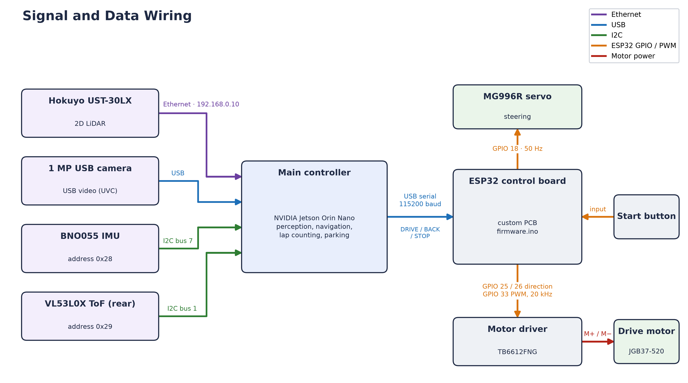
</div>

The Jetson performs perception and navigation. It reads the Hokuyo LiDAR over
Ethernet, the camera over USB, and the BNO055 and VL53L0X over I2C. It then
sends text commands over USB serial to the ESP32, which controls the rear motor
and steering servo.

| Device | Interface |
| --- | --- |
| Hokuyo UST-30LX | Ethernet, `192.168.0.10:10940` |
| ESP32 controller | USB serial, `/dev/ttyUSB0`, 115200 baud |
| 1 MP camera | Linux video device 0 |
| BNO055 IMU | I2C bus 7, address `0x28` |
| Rear VL53L0X | I2C bus 1, address `0x29` |
| MG996R steering servo | ESP32 GPIO 18 |
| TB6612FNG motor inputs | ESP32 GPIO 25, 26 and 33 |

The ESP32 accepts three newline-terminated commands:

```text
DRIVE <steering> <pwm>
BACK <steering> <pwm>
STOP
```

Two batteries isolate the computer supply from actuator current changes:

- **Battery A** connects directly to the Jetson through its barrel-power cable.
- **Battery B** supplies the control and actuator side. An XL4016 rail at
  approximately 11 V serves the ESP32/motor/LiDAR path, while an XL4015 at 5 V
  supplies the MG996R servo.

The current power diagram, signal diagram, datasheet-based power budget and
known electrical limitations are documented in [`schemes/`](schemes/).

### Component and Interface Map

Document every major electronic component used in the robot.

| Component  | Exact model  | Interface  | Purpose  | Details  |
| :--- | :--- | :--- | :--- | :--- |
| <p align="center">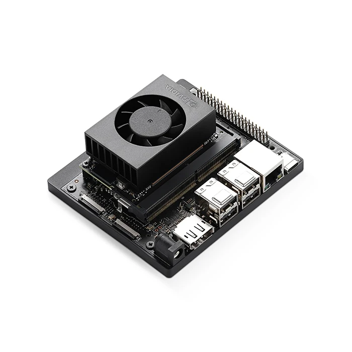</p> | NVIDIA Jetson Orin Nano | NaN | Main processing | [LINK](https://www.amazon.com/dp/B0BZJTQ5YP) |
| <p align="center"></p> | Custom ESP32-WROOM-Based PCB | Serial | Actuator control | NO LINK |
| <p align="center">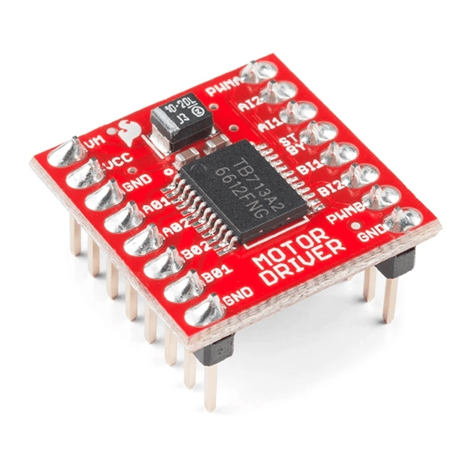</p> | TB6612FNG | PWM | Drive-motor control | [LINK](https://www.amazon.com/Sparkfun-PID-14451-Motor-Driver/dp/B01MF67DX6) |
| <p align="center">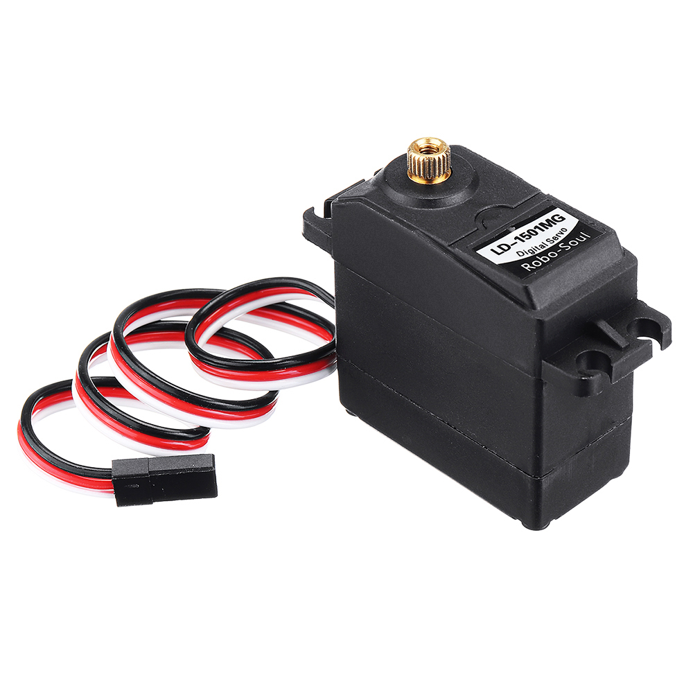</p> | LD-1501MG Servo | PWM | Front steering | [LINK](https://www.ebay.com/itm/362680017196) |
| <p align="center">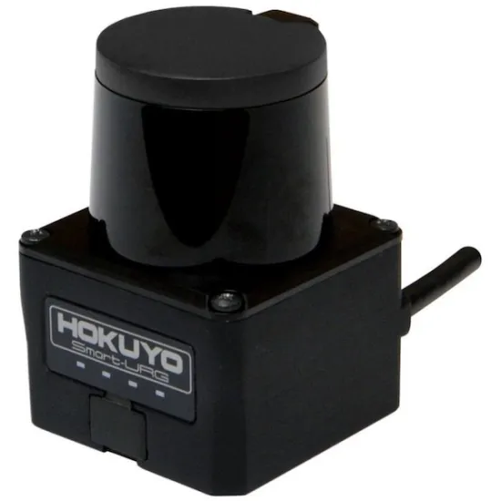</p> | Hokuyo UST-05LN LiDAR | Ethernet (100BASE-TX) | Distance measurement, wall and obstacle detection | [LINK](https://www.generationrobots.com/en/403397-hokuyo-ust-05ln-lidar.html) |
| <p align="center">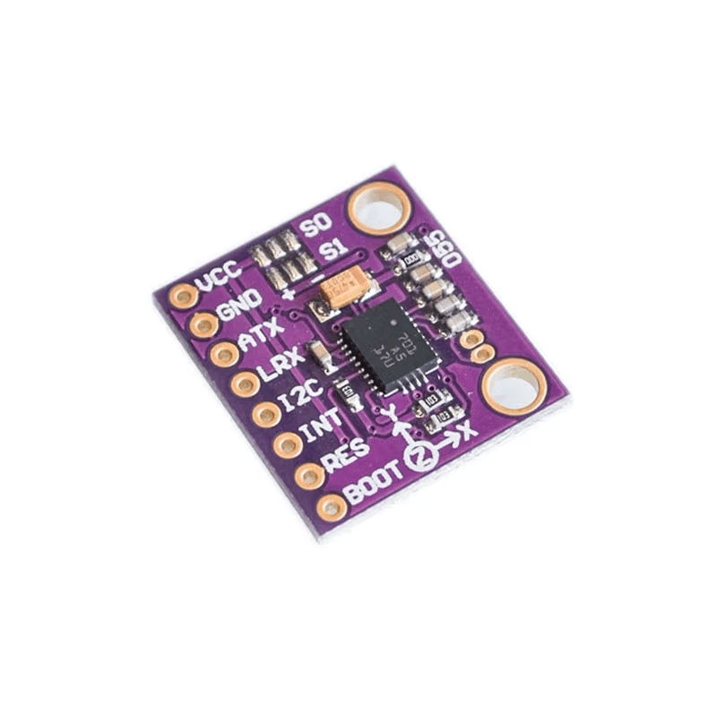</p> | BNO055 | I²C | Relative yaw | [LINK](https://bdelectronics.xyz/product/bno055-intelligent-9axis-attitude-sensor-module) |
| <p align="center">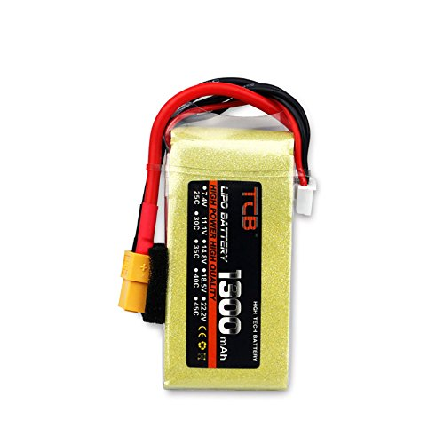</p> | TCB 1100mAh 3S 25C battery (Jetson battery) | Power | Logic power | [LINK](https://rcdrone.top/products/tcb-2s-3s-4s-5s-6s-7s-8s-1100mah-25c-lipo-battery-with-xt60-plug-for-rc-planes-fpv-drones-helicopters-cars) |
| <p align="center"></p> | TCB 1100mAh 3S 25C battery (motor battery) | Power | Actuator power | [LINK](https://rcdrone.top/products/tcb-2s-3s-4s-5s-6s-7s-8s-1100mah-25c-lipo-battery-with-xt60-plug-for-rc-planes-fpv-drones-helicopters-cars) |
| <p align="center">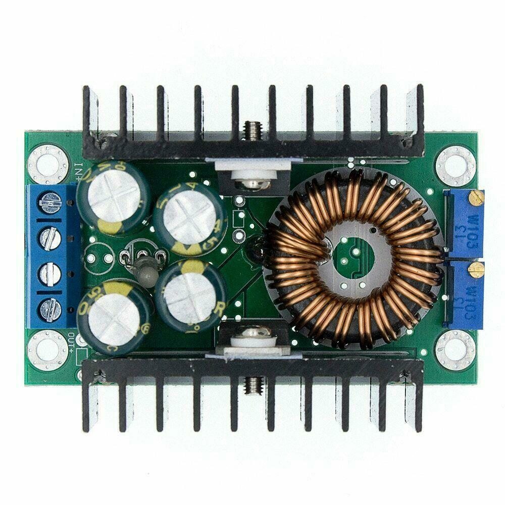</p> | XL4016 300W buck-boost converter (11V) | Power | Actuator power | [LINK](https://ampere-electronics.com/product/xl4016-dc-dc-step-down-converter-module-12a-300w/) |
| <p align="center">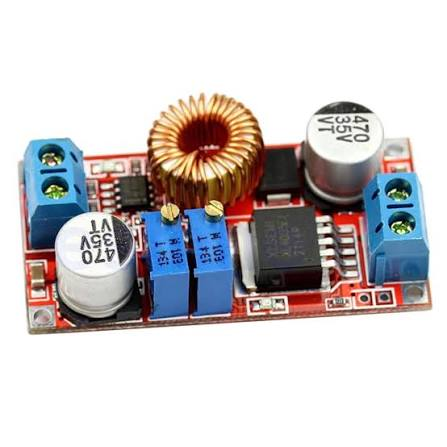</p> | XL4015 50W buck converter (5V) | Power | Actuator power | [LINK](https://www.jacobsparts.com/items/DCMOD-B) |
| <p align="center">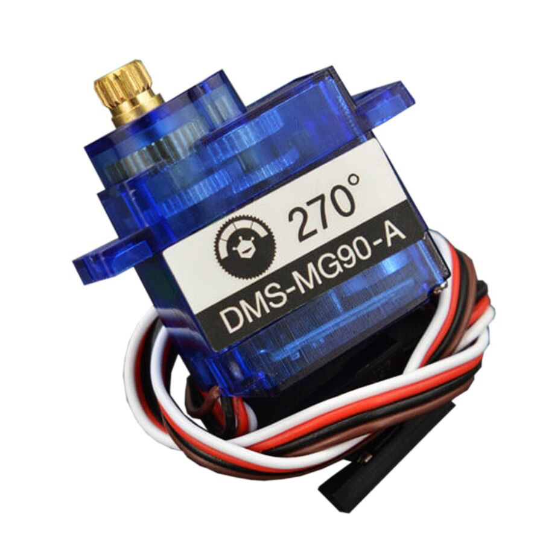</p> | 270° Servo Motor | Actuator | Steering control | [LINK](https://www.robotshop.com/products/dfrobot-9g-270metal-servo-w-analog-feedback-15kg?srsltid=AYCX9vKwMUjuMalmhNaUifvoxJB40ZVc4YlXLCpqEJC7qc9iaZxd4toI) |

### Sensor placement and calibration

| Sensor | Placement | Selection reason | Calibration | Limitation and mitigation |
| --- | --- | --- | --- | --- |
| Hokuyo LiDAR | Mounted at the front of the robot on a 3D-printed angled base, with a clear view of the track | Provides accurate distance data for wall following, obstacle detection, and distance measurement | Mounted level and securely; distance readings are tested at known distances and filtered | Readings can be noisy on reflective or very close surfaces. Filtering and fallback control logic are used |
| BNO055 | Mounted on the upper section of the robot chassis, near the center and away from motors and power wiring as much as possible | Provides orientation and heading data for more stable navigation and turning | Calibrated according to the sensor's required motion/orientation procedure before operation | Magnetic interference and vibration can affect accuracy. The sensor is mounted securely, kept away from high-current components where possible, and readings are validated |

**Detailed evidence:** [electrical architecture, wiring, power budget, sensor placement, calibration, and safety](schemes/)

## Software and Challenge Strategy

### Software Architecture and Communication

The robot's software is written in **Python 3** and runs on the **NVIDIA Jetson Orin Nano**. A separate **ESP32** runs the motor and steering firmware. The Jetson program runs several threads at once: one reads the LiDAR, one runs the YOLO camera model, one runs the main controller, and one serves a live web viewer (Flask, port 5000).

**Libraries:** `numpy`, `opencv-python`, `ultralytics` (YOLOv8), `pyserial`, `flask`, `hokuyolx`, `smbus2`, `adafruit-extended-bus`, `adafruit-circuitpython-vl53l0x`.

**Communication:**

| Link | Connection | Details |
|---|---|---|
| Jetson ↔ ESP32 | USB serial (`/dev/ttyUSB0`) | 115200 baud, text commands such as `DRIVE <steering> <pwm>`, `BACK <steering> <pwm>` and `STOP` |
| Jetson ↔ Hokuyo LiDAR | Ethernet | `192.168.0.10`, port `10940` |
| Jetson ↔ BNO055 IMU | I2C bus 7 | Address `0x28`, yaw read from the Euler heading registers |
| Jetson ↔ rear VL53L0X | I2C bus 1 | Rear distance during parking |
| Jetson ↔ camera | USB | Read with OpenCV (V4L2) |

| Module | Responsibility | Inputs | Outputs |
|---|---|---|---|
| AI Model | Detects red and green pillars in the camera image with YOLOv8n (`best1.pt`) and converts each detection into an angle range, so the controller can tell a pillar from a wall | Camera frames | Pillar color, confidence and angle range, plus an annotated preview image for the web viewer |
| Main Controller | Runs the wall-following and pillar-avoidance state machine, holds and recovers heading from the IMU, counts laps, applies the safety checks, and runs the parking sequence | LiDAR front, side and front-left distances, IMU yaw, pillar detections, pillar layout JSON, rear VL53L0X distance (parking) | A steering angle and PWM command sent to the ESP32 every 0.05 s, and status data for the web viewer |
| Microcontroller Firmware | Turns the commands from the Jetson into steering servo and motor output, and stops the vehicle on a `STOP` command or if commands stop arriving | Serial commands from the Jetson (steering angle, PWM, direction) | Servo position and motor PWM |


### AI Model and Computer Vision Pipeline

IriSight's perception stack combines LiDAR-based geometric sensing with a trained computer vision pipeline running on the **Jetson Orin Nano**. The camera provides the color stream used for pillar detection, and the **Hokuyo LiDAR** provides the distances used for navigation.

The perception system uses two complementary approaches:

- **LiDAR processing** for wall following and distance measurement
- **YOLOv8n object detection** for red and green pillar recognition

#### Detection Model

- **Model:** YOLOv8n (nano) — chosen for its speed/accuracy tradeoff, allowing it to run in real time on the Jetson alongside the LiDAR-processing pipeline.
- **Classes:** `greenbox`, `redbox`, `xparking` (the current control programs use only the red and green pillar classes)
- **Input size:** 640 × 640
- **Inference:** Runs on the Jetson Orin Nano using `ultralytics`, consuming the camera stream at a confidence threshold of 0.65.
- **LiDAR integration:** Each YOLO bounding box is converted into an estimated angle range, using the camera's field of view and mounting offset. That range is compared with the LiDAR sectors to decide whether a LiDAR return belongs to a pillar or a wall, rather than relying on position in the 2D image alone.
- **Training run:** 100 epochs, batch size 8, auto optimizer, `lr0 = 0.01`.
- **Validation performance:** Precision ≈ 0.997, recall ≈ 0.985, mAP@50 ≈ 0.995, mAP@50–95 ≈ 0.928.
- **Weights file:** `best1.pt` — the best checkpoint by validation fitness, used directly for inference on the robot.

#### Dataset and Training Workflow

The training dataset was developed using a **semi-supervised annotation workflow**. The full labeled dataset is browsable on [Roboflow](https://universe.roboflow.com/damian-igwmf/wro-detection-47xs2-ahmqb).

1. **Manual annotation** — Approximately 300 images were manually annotated using **CVAT** to create the initial training set.
2. **Pseudo-labeling** — The trained model was used to automatically generate labels for additional unlabeled images.
3. **Manual correction** — The predicted labels were reviewed and corrected in CVAT.
4. **Dataset expansion** — The corrected annotations were added back into the training dataset, and the process was repeated to improve the model without manually annotating every frame from scratch.

Supporting scripts are used to:

- Organize images and labels
- Split the dataset into training and validation sets
- Test trained model checkpoints
- Run inference using a webcam
- Run inference directly on the Jetson Orin Nano

This workflow allows new model checkpoints to be validated before deployment into the competition control programs.

> **Note:** [`src/ai_model/README.md`](src/ai_model/README.md) documents the model checkpoint itself (`conf=0.5`, `imgsz=640`) for standalone testing (e.g. `yolo detect predict`). The live Obstacle Challenge scripts load the same `best1.pt` weights but call it with `conf=0.65` and the default 640 input size.

#### How the Model Output Is Used in Control

The vision model does **not directly control the robot**. Instead, its output is passed to the existing **wall-following and pillar-avoidance state machine**.

The main uses of the model output are:

- **Pillar layout scan:** Before the run, the servo-mounted camera scans the field, detects the pillar colors and positions, and stores the layout in a JSON file. The control program reads this file to know the color and order of the pillars on each side.
- **Pillar vs wall check:** During the run, a detected pillar at a LiDAR angle stops the robot from treating that return as a wall or a wall opening, so it does not follow or turn against a pillar by mistake.
- **Pillar distance:** The LiDAR distance to the front obstacle determines when the robot should begin avoidance and how aggressively it should react.
- **Obstacle avoidance:** Separate control parameters for green and red pillars allow the robot to apply different steering responses depending on the pillar color. Green pillars are passed on one side, while red pillars are passed on the other.
- **Error clamping:** Steering commands and heading errors are constrained to prevent excessive corrections and reduce oversteering.
- **Parking maneuver:** Once the required laps are complete, the robot reverses into the parking space using the rear VL53L0X distance sensor and the front LiDAR.
- **Safety backup:** Emergency-stop checks on every LiDAR sector, a stale-scan timeout, and per-maneuver timeouts stop the robot if a detection is missed or a reading is lost. A pillar detection never overrides these checks.

The system therefore separates **perception** from **control**:

```text
Camera ──► YOLOv8n ──► Pillar Color + Angle Range ──┐
                                                    │
Hokuyo LiDAR ──► Front / Side Distances ────────────┤
                                                    ▼
BNO055 IMU ──► Yaw ─────────────────────► State Machine
                                                    │
                                                    ▼
                                           Steering + Speed
                                                    │
                                                    ▼
                                                  ESP32
```
### Modelling with MATLAB

For the MathWorks Modeling Award, [`matlab_simulink/`](matlab_simulink/)
holds MATLAB scripts that model two parts of the robot. They need only base
MATLAB (desktop or MATLAB Online), and every robot value lives in one file,
[`robot_parameters.m`](matlab_simulink/scripts/robot_parameters.m), labelled
with its source (CAD, measured, program or estimate).

- **Steering linkage.** [`steering_geometry.m`](matlab_simulink/scripts/steering_geometry.m)
  treats the knuckles and steering link as a four-bar linkage and solves it
  with `fzero` at every angle, using the CAD dimensions. The steering-arm lines
  meet 165.1 mm behind the kingpins, 97.7 % of the 169.0 mm wheelbase, so the
  textbook design rule is almost met. The full model shows that the real
  linkage still gives **56–70 % of ideal Ackermann**: the inner wheel always
  turns more than the outer wheel, but less than ideal. A hand-derived
  small-angle formula gives 56.7 %, which matches MATLAB's 55.7 % at 5°.
- **Open Challenge.** [`simulate_open_challenge.m`](matlab_simulink/scripts/simulate_open_challenge.m)
  drives a kinematic bicycle model of the robot around the WRO track, with a
  simulated 1,081-beam Hokuyo scan and a line-by-line MATLAB copy of the Open
  Challenge controller. [`sweep_open_challenge.m`](matlab_simulink/scripts/sweep_open_challenge.m)
  tries every combination of top speed and steering ratio on 1.0 m and 0.6 m
  corridors. The first runs use the estimated speed and steering ratio and
  show that the program's 2.0 s corner limit needs a top speed of about
  0.8 m/s, and that a 0.6 m corridor can end a corner early at about 60°.

The models, results, validation plan and run commands are in
[`matlab_simulink/README.md`](matlab_simulink/README.md).

### Navigation and Control Strategy

**Open Challenge.** The robot follows the inner wall using the LiDAR side distance. When the front distance drops and a side opens up, it detects a corner and turns. The BNO055 tells it when the turn is finished and counts laps, and after 3 laps it stops. There are separate clockwise and counter-clockwise programs.

**Obstacle Challenge.** The same wall-following base, plus pillar handling. The pillar layout comes from a JSON file listing 2 pillars for each of the four sections of the field. When the robot reaches a pillar, it uses the LiDAR front distance to decide when to start avoiding, and passes green and red pillars on opposite sides with separate steering parameters for each color. YOLO detections are converted to an angle range so a LiDAR return that belongs to a pillar isn't mistaken for a wall or a wall opening.

**Heading and steering.** The IMU yaw is the reference for turns and for recovering the heading after avoiding a pillar. Steering and heading errors are clamped (±29° Open, ±35° Obstacle, up to ±38° in some maneuvers, ±50° in parking) to avoid oversteering.

**Parking.** After the last lap the robot reverses into the parking space using the rear VL53L0X and the front LiDAR.

**Safety.** Every cycle (0.05 s) checks all LiDAR sectors for an emergency stop and checks that the scan is fresh. Each maneuver has a timeout, and any fault sends `STOP`.

### Challenge Implementation

```text
LiDAR ─────────────┐
BNO055 ────────────┤
USB camera + YOLO ─┼──> Jetson navigation ──USB serial──> ESP32 ──> motor + steering
Rear VL53L0X ──────┘              │
                                  └──> testing dashboard on port 5000
```

### Open Challenge

Separate clockwise and counter-clockwise programs use LiDAR wall following,
corner detection and BNO055 heading for turn completion and lap counting.
Both directions have been tested successfully by the team. Formal trials on
the final mechanical configuration still need dated logs.

- [`open_clockwise.py`](src/main_controller/open_challenge/open_clockwise.py)
- [`open_counter_clockwise.py`](src/main_controller/open_challenge/open_counter_clockwise.py)

### Obstacle Challenge

The obstacle programs combine LiDAR geometry, BNO055 heading, YOLO pillar
classification, a direction-aware pillar map and the rear ToF sensor for final
parking. Counter-clockwise is the current calibration baseline. The clockwise
program mirrors the same direction-aware architecture; its final physical
regression results remain to be recorded. Final-parking logic exists for both
directions, with one minor counter-clockwise parking-entry refinement in
progress.

The planned perception flow is designed around the limitations of the small
camera:

1. Before driving, pan the camera to three angles while the robot is stationary.
2. Use dynamic HSV color checks together with YOLO detections to classify the
   visible pillars.
3. Fuse the three views and write a frozen JSON pillar map.
4. During the run, read that map and use LiDAR/IMU feedback for deterministic
   navigation instead of relying on continuous camera decisions while the
   robot vibrates and changes pose.

The current challenge programs consume the JSON map, but camera-servo control,
multi-view fusion and automatic JSON generation are not yet integrated. This
is the intended architecture, not a claim that the complete mapping generator
already exists.

- [`obstacle_clockwise.py`](src/main_controller/obstacle_challenge/obstacle_clockwise.py)
- [`obstacle_counter_clockwise.py`](src/main_controller/obstacle_challenge/obstacle_counter_clockwise.py)
- [Obstacle strategy and current implementation boundary](src/main_controller/obstacle_challenge/)

### Test Results

| Metric | Challenge 1 | Challenge 2 |
|---|---|---|
| Number of Trials | [Value] | [Value] |
| Successful Runs | [Value] | [Value] |
| Success Rate | [Value] | [Value] |
| Best Completion Time | [Value] | [Value] |
| Average Completion Time | [Value] | [Value] |

---

## Engineering decisions, constraints and risk controls

| Constraint or observed failure | Decision and evidence | Trade-off or remaining risk |
| --- | --- | --- |
| National RealSense produced noisy readings on its left side | Separate geometry and color sensing: Hokuyo LiDAR for range, small USB camera for classification | LiDAR cannot identify color; camera calibration and a reliable cable remain important |
| National parallel steering scrubbed during turns | Build the close-Ackermann linkage documented by the CAD calculation | More printed joints and retention points than the parallel mechanism |
| Separate motor/differential supports vibrated | Integrate both supports into one mount; vibration became almost imperceptible in team testing | The combined part is larger and must be reprinted as one piece if damaged |
| Right rear axle moved outward at higher speed | Add space for another Technic bush in the 13 October mount refinement | The bush position is checked in every pre-run inspection |
| Printed steering pins broke or migrated vertically | Use solid extended pivots with transverse M2.5 retention screws | Adds screws to the printed joint; the M2.5 pivot screws are checked in every pre-run inspection |
| Complete robot length is 298 mm against a 300 mm limit | Cantilever the LiDAR mount and integrate the front guard below the scan plane | Only 2 mm margin remains, so any cable or mount change requires remeasurement |
| Camera detection became unstable while the robot vibrated and changed pose | Plan a stationary three-angle scan followed by frozen-map navigation | The scan must classify the complete field correctly before movement; incomplete maps must stop rather than guess |
| Motor and servo current changes could disturb the Jetson | Use separate controller and actuator batteries with a shared signal ground | Adds mass and wiring; no fuse is installed and converter voltages need physical remeasurement |
| Lost Jetson–ESP32 commands could leave the last motor command active | Jetson controllers issue `STOP` on faults and exit | ESP32 command timeout is not yet implemented, so link loss remains an explicit safety risk |

The detailed failure → change → retest chains are preserved in the
[Engineering Journal](other/engineering_journal/), electrical failure points
in [`schemes/`](schemes/), and repeatable acceptance procedures in
[`other/testing/`](other/testing/).

---

## Reproducing IriSight

### Required Files and Tools

**Hardware:**

- NVIDIA Jetson Orin Nano, custom ESP32-WROOM PCB
- Hokuyo UST-30LX LiDAR (Ethernet), 1 MP USB camera on a DMS-MG90-A 270° pan servo, BNO055 IMU, VL53L0X ToF sensor
- JGB37-520 12 V 100 RPM motor, TB6612FNG driver, MG996R steering servo
- Two TCB 3S 1100 mAh 25C LiPo packs, XL4016 buck converter (about 11 V), XL4015 buck converter (5 V)
- LEGO mechanical differential, LEGO axles and Technic bushes, four LEGO 39367pb01 wheels
- 3D-printed PLA parts from `models/` (chassis plate, standoffs, electronics deck, mounts, steering parts), M2.5 screws

**Software and Tools:**

- Jetson with JetPack SDK, Python 3
- Libraries: `numpy`, `opencv-python`, `ultralytics`, `pyserial`, `flask`, `hokuyolx`, `smbus2`, `adafruit-extended-bus`, `adafruit-circuitpython-vl53l0x`
- Arduino IDE or PlatformIO for the ESP32 firmware
- CVAT (only if retraining the model)

### Mechanical Assembly

1. Print the parts in `models/` in PLA (see the print settings there).
2. Fit the rear drivetrain: couple the JGB37-520 to the LEGO differential with the JGB-to-LEGO coupler, then mount them in the Integrated Motor–Differential Mount V2. Add the extra Technic bush on the right rear axle.
3. Mount the drivetrain module on the Main Chassis Plate V2 and fit the four LEGO wheels.
4. Assemble the front steering: knuckles, crossmember, steering link and servo mount with the MG996R. Secure the pivots with the M2.5 screws and check the wheels move through the full range without binding.
5. Attach the six 42 mm standoffs and the Integrated Electronics Mounting Deck V1.
6. Mount the LiDAR with its impact guard at the front, the camera mount and pan servo, the Jetson platform with the rear VL53L0X, and the two batteries on the deck.
7. Measure the finished robot. The length margin is only 2 mm (298 mm of 300 mm), so remeasure after any cable or mount change.

### Wiring and Power-On

Follow the wiring diagrams in [`schemes/`](schemes/).

| Connection | Pin / Interface |
|---|---|
| Jetson to ESP32 | USB serial `/dev/ttyUSB0`, 115200 baud |
| LiDAR | Ethernet, `192.168.0.10:10940` |
| BNO055 | I2C bus 7, `0x28` |
| Rear VL53L0X | I2C bus 1, `0x29` |
| Steering servo | ESP32 GPIO 18 |
| TB6612FNG inputs | ESP32 GPIO 25, 26, 33 |

Power-on order:

1. Connect Battery A to the Jetson and let it boot.
2. Check that the ESP32 prints `ESP32 ready` and shows up as `/dev/ttyUSB0` with Battery B still disconnected.
3. Check the LiDAR, IMU, camera and rear ToF in the web viewer.
4. Connect Battery B last, with the wheels off the ground for the first powered test.

## Software Installation

#### 1. Clone the repository

```bash
git clone https://github.com/WRO-2026-AUPP/WRO_IriSight.git
```

#### 2. Navigate to the project directory

```bash
cd WRO_IriSight
```

#### 3. Install the required Python packages 

The following packages are required for numerical processing, computer vision, RealSense D455 depth sensing, YOLOv8 object detection, and Jetson-to-ESP32 serial communication.

```bash
pip install numpy
```
```bash
pip install opencv-python
```
```bash
pip install pyrealsense2
```
```bash
pip install ultralytics
```
```bash
pip install pyserial
```
#### 4. Verify the installation

```bash
python3 -c "import cv2, numpy, pyrealsense2, ultralytics, serial; print('All required packages installed successfully.')"
```

### Start an Autonomous Run

Select the control program for the challenge and driving direction. Before starting, make sure the Jetson Orin Nano, Hokuyo LiDAR, BNO055 IMU, camera and ESP32 are connected (the obstacle run also uses the rear VL53L0X distance sensor). Keep the robot still for the first few seconds so the IMU can set its starting heading.

#### 1. Open Challenge — Clockwise

```bash
python3 src/open_challenge/open_clockwise.py
```

#### 2. Open Challenge — Counter Clockwise

```bash
python3 src/open_challenge/open_counter_clockwise.py
```

#### 3. Obstacle Challenge — Clockwise

```bash
python3 src/obstacle_avoidance/obstacle_clockwise.py wro_pillars.json
```

#### 4. Obstacle Challenge — Counter Clockwise

```bash
python3 src/obstacle_avoidance/obstacle_counter_clockwise.py wro_pillars.json
```

The obstacle programs read the pillar layout from the JSON file and need `best1.pt` in the same folder. The robot starts moving once it has valid sensor data. Press Ctrl+C to stop it, and open `http://<jetson-ip>:5000` to watch the live viewer.


### Pre-flight and acceptance test

Before any competition run or timed trial, the following checklist is completed in order:

**Mechanical checks**
- [x] All three 3D-printed mounts (Jetson & Battery Container V3, Motor Mount V4, Camera Mount V2) are pinned securely with no play
- [x] Front wheels turn freely through the full steering range with no binding (the Open Challenge program limits steering to ±29°, the Obstacle Challenge program to ±35°, and some obstacle maneuvers command up to ±38°, parking up to ±50°)
- [x] Rear wheels and drive shaft spin freely with the motor disconnected (no mechanical drag)
- [x] Vehicle is on a stand with wheels off the ground before any powered test

**Power and connectivity checks**
- [x] Jetson battery connected first; Jetson boots
- [x] ESP32 flashed and powered independently; prints `ESP32 ready` over serial with motor battery disconnected; appears as `/dev/ttyUSB0` on the Jetson
- [x] Hokuyo LiDAR powered and reachable at `192.168.0.10`, port `10940`
- [x] BNO055 responds on I2C bus 7 (address `0x28`)
- [x] Camera opens at index 0 (Obstacle Challenge)
- [x] Rear VL53L0X responds on I2C bus 1 (address `0x29`) (Obstacle Challenge)
- [x] Motor/actuator battery connected last, only after the above checks pass
- [x] TB6612FNG and servo wiring re-checked against pinout (IN1=D26, IN2=D25, PWM=D33, servo=D17)

**Sensor checks (in the web viewer, port 5000)**
- [x] LiDAR front, left, right and front-left readings tested against a known-distance object
- [x] Yaw reads correctly. The robot is placed in its starting position and kept completely still for the first ~2 seconds after the program starts, while the BNO055 sets its zero heading
- [x] Camera view shows red and green pillars with detection boxes (Obstacle Challenge)

**Software checks**
- [x] Correct challenge/direction script confirmed before start (`open_clockwise.py`, `open_counter_clockWise.py`, `obstacle_clockwise.py`, or `obstacle_counter_clockwise.py`)
- [x] Open Challenge: the robot starts driving on its own as soon as it receives valid LiDAR scans, so it is placed beside the inner wall before the program is started
- [x] Obstacle Challenge: `best1.pt` is in the folder the program is run from, and the pillar layout JSON is passed as the argument (`python3 <script> wro_pillars.json`). The JSON has exactly 2 pillars for each of the top, left, bottom and right sections, and matches the field
- [x] Obstacle Challenge: `DRY_RUN` is `False` for a real run
- [x] Obstacle Challenge: the area around the parking start is clear, because the parking exit is a timed sequence that does not use sensor checks
- [x] Flask page reachable and showing live distances, state, steering and yaw (Lap x/3 on the Open Challenge page; stage and camera view on the Obstacle Challenge page)
- [x] Ctrl+C stops the robot (sends `STOP`) and the operator is ready to use it

**Acceptance criteria**

A build is considered competition-ready only if it meets the targets already demonstrated in [Final regression results](#final-regression-results): 3/3 successful trials for both directions of the Open Challenge, and 3/3 successful trials for both directions of the Obstacle Challenge, each with no navigation failure or collision.

---

## Current Limitations and Future Improvements

| Limitation | Current Effect | Planned Improvement | Validation Target |
|---|---|---|---|
| [Limitation 1] | [Effect] | [Improvement] | [Target] |
| [Limitation 2] | [Effect] | [Improvement] | [Target] |
| [Limitation 3] | [Effect] | [Improvement] | [Target] |

## National Round Archive

The complete National Round project has been preserved in:

`other/legacy_national/`

This archive contains the original source code, AI model, CAD designs, electrical diagrams, photographs, and supporting documentation.

It is retained as a reference for the International Round development.

## License

The source code and documentation are released under the [MIT License](LICENSE.txt).

**Team IriSight — AUPP, Cambodia**

*World Robot Olympiad 2026 — International Final*


