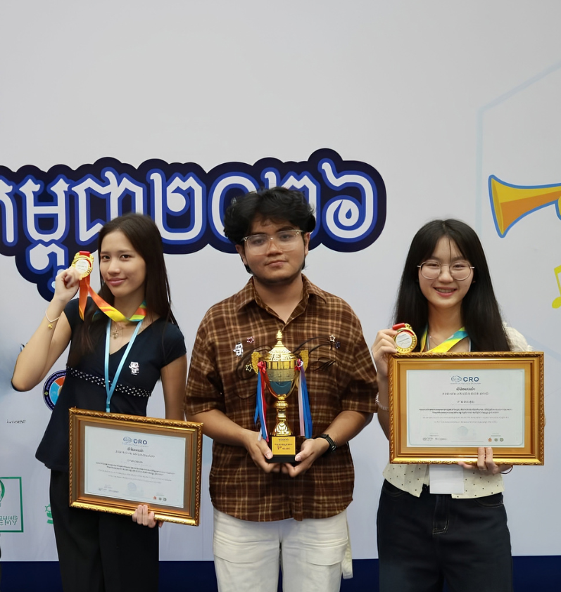
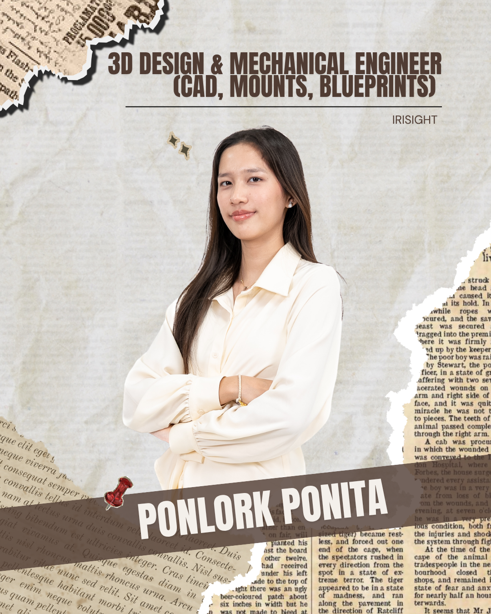
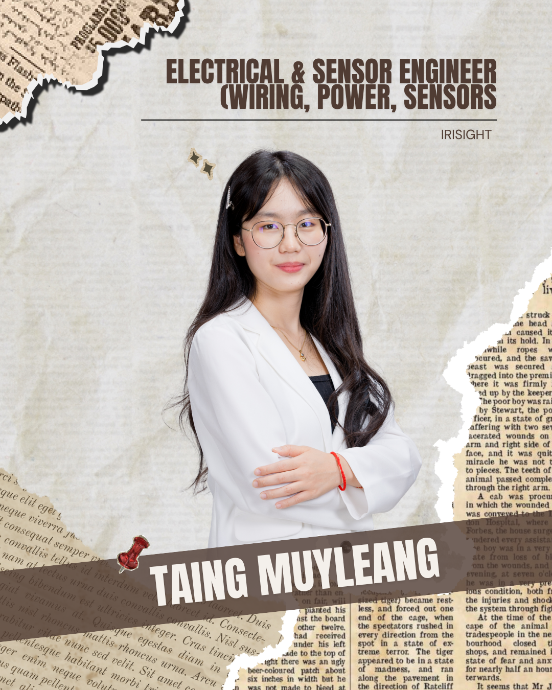
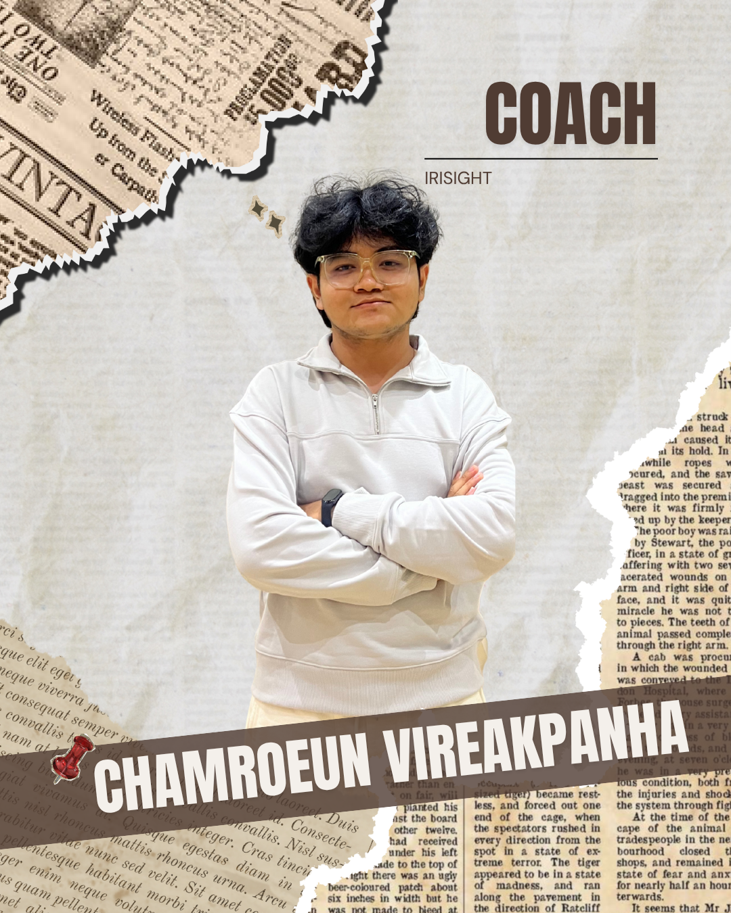
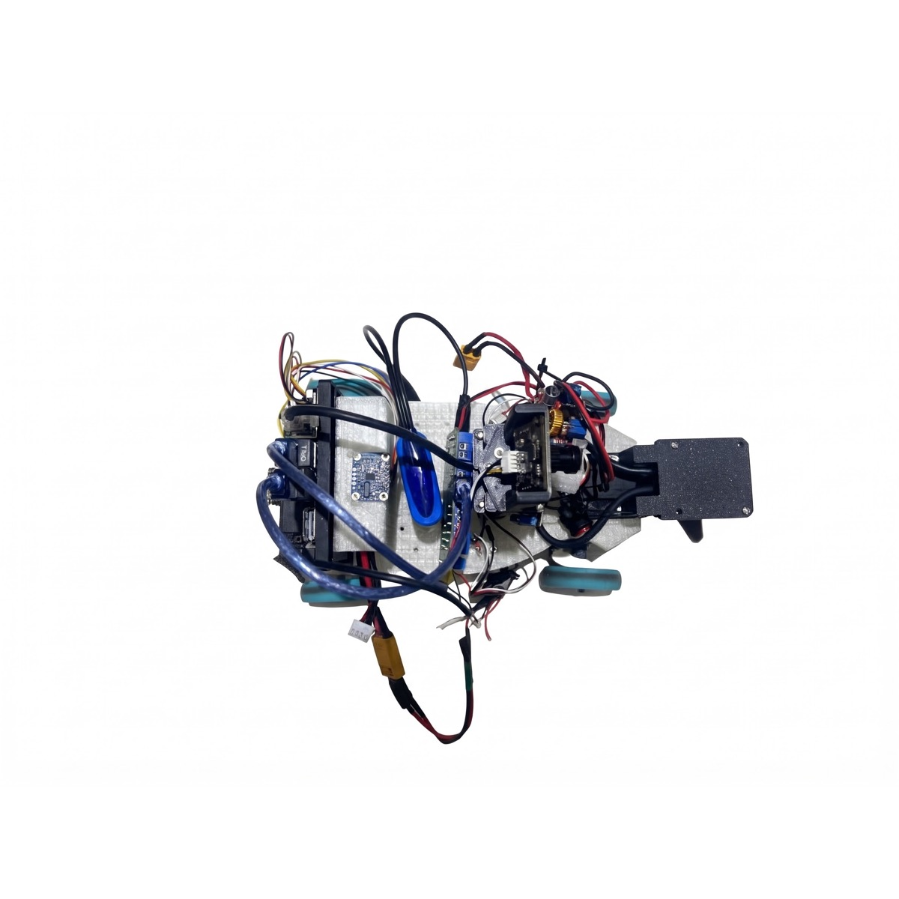
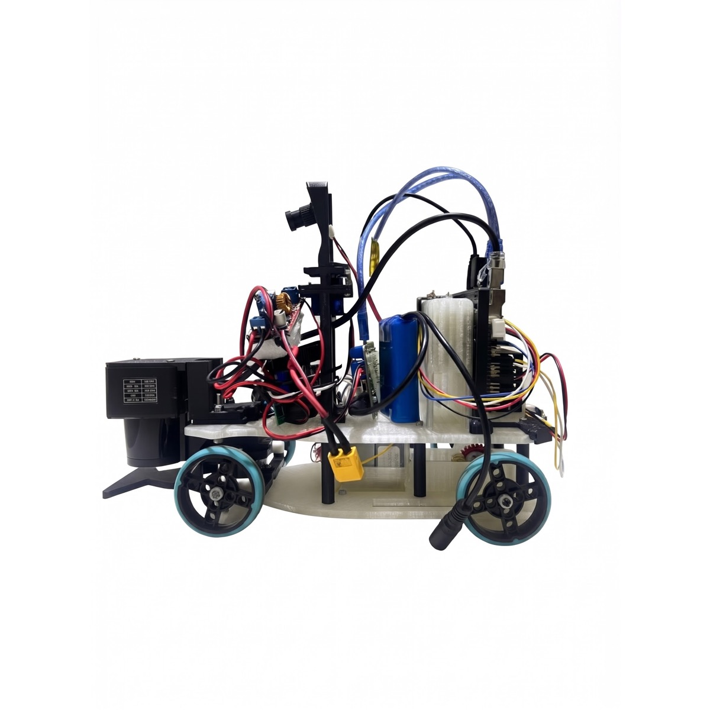
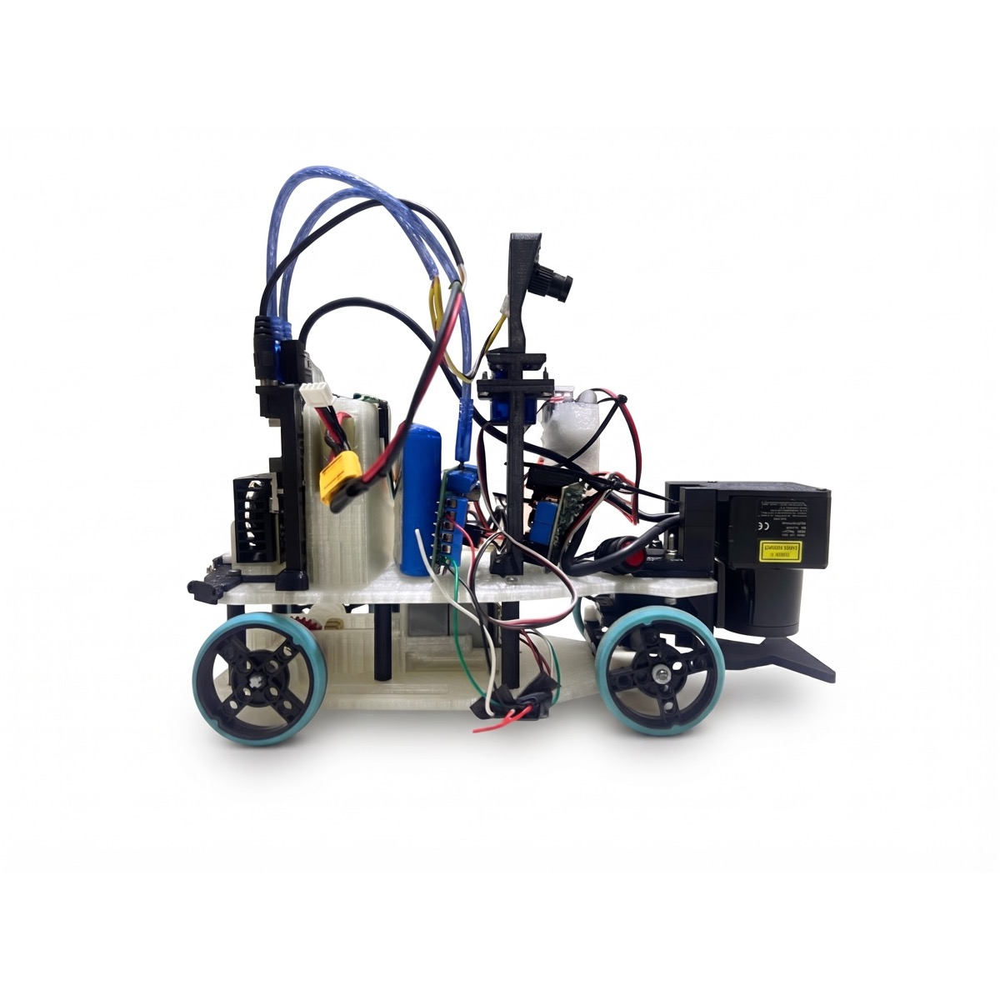
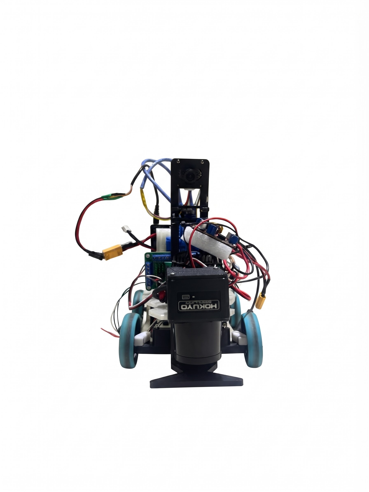
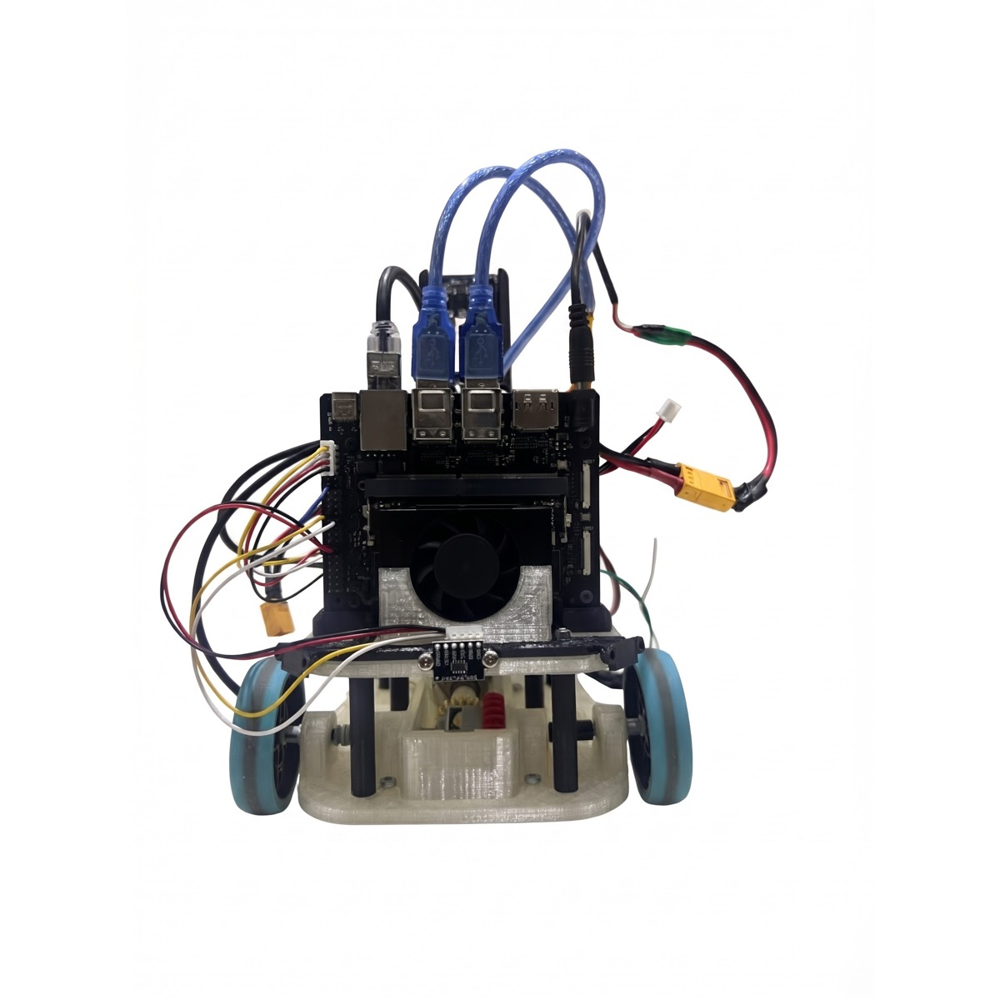

# IriSight — WRO Future Engineers 2026

*Repository of Team IriSight competing in the WRO 2026 International Final, Future Engineers category.*

<div align="center">

<!-- Add International Round project banner here -->


<p><em>"Break, Fix, Repeat"</em></p>
</div>

## Quick Link - Explore the project

<table width="100%">
  <tr>
    <td width="33.33%" align="center" valign="top">
      <a href="src/"><strong>💻 Code</strong></a><br>
      <sub>Jetson and ESP32 control code</sub>
    </td>
    <td width="33.33%" align="center" valign="top">
      <a href="schemes/"><strong>🔌 Schematics</strong></a><br>
      <sub>Wiring, power, and electronics</sub>
    </td>
    <td width="33.33%" align="center" valign="top">
      <a href="models/"><strong>🧩 CAD models &amp; Mechanics</strong></a><br>
      <sub>Mechanical design and printable files</sub>
    </td>
  </tr>
  <tr>
    <td width="33.33%" align="center" valign="top">
      <a href="v-photos/"><strong>🚗 Vehicle Photos</strong></a><br>
      <sub>Required views of the final robot</sub>
    </td>
    <td width="33.33%" align="center" valign="top">
      <a href="t-photos/"><strong>👥 Team Photos</strong></a><br>
      <sub>Official and informal team photos</sub>
    </td>
    <td width="33.33%" align="center" valign="top">
      <a href="video/"><strong>🎥 Videos</strong></a><br>
      <sub>Autonomous challenge demonstrations</sub>
    </td>
  </tr>
</table>

## Contents

- [Repository Structure](#repository-structure)
- [Meet the Team](#meet-the-team)
- [Meet the Vehicle](#meet-the-vehicle)
  - [Final Vehicle Gallery](#final-vehicle-gallery)
  - [Key Specifications](#key-specifications)
- [Performance Videos](#performance-videos)
- [How IriSight Works](#how-irisight-works)
  - [System Architecture](#system-architecture)
- [Our Engineering Journey](#our-engineering-journey)
  - [Engineering Design and Iterations](#engineering-design-and-iterations)
  - [Final Engineering Blueprints](#final-engineering-blueprints)
- [Mobility and Mechanical Design](#mobility-and-mechanical-design)
  - [Chassis and Component Mounting](#chassis-and-component-mounting)
  - [Drive System](#drive-system)
  - [Steering System](#steering-system)
  - [Mechanical Iterations](#mechanical-iterations)
- [Power and Sensor Architecture](#power-and-sensor-architecture)
  - [Power Architecture](#power-architecture)
  - [Component and Interface Map](#component-and-interface-map)
  - [Sensor Placement and Calibration](#sensor-placement-and-calibration)
- [Software and Challenge Strategy](#software-and-challenge-strategy)
  - [Software Architecture and Communication](#software-architecture-and-communication)
  - [AI Model and Computer Vision Pipeline](#ai-model-and-computer-vision-pipeline)
  - [Navigation and Control Strategy](#navigation-and-control-strategy)
  - [Challenge Implementation](#challenge-implementation)
  - [Test Results](#test-results)
- [System Integration, Testing, and Risk](#system-integration-testing-and-risk)
  - [Subsystem Interaction](#subsystem-interaction)
  - [Final Regression Results](#final-regression-results)
  - [Key Engineering Decisions](#key-engineering-decisions)
  - [Risk Register](#risk-register)
- [Reproducing IriSight](#reproducing-irisight)
  - [Required Files and Tools](#required-files-and-tools)
  - [Mechanical Assembly](#mechanical-assembly)
  - [Wiring and Power-On](#wiring-and-power-on)
  - [Software Installation](#software-installation)
  - [Calibration](#calibration)
  - [Starting an Autonomous Run](#starting-an-autonomous-run)
  - [Pre-flight and Acceptance Test](#pre-flight-and-acceptance-test)
- [Current Limitations and Future Improvements](#current-limitations-and-future-improvements)
- [National Round Archive](#national-round-archive)
- [License](#license)

---

## Repository Structure

This repository is organized as follows:

```
📦 WRO_IriSight
├── 📁 media                    # Project banner and media
│
├── 📁 models                   # International Round CAD models
│
├── 📁 other                    # Additional documentation and archived projects
│   └── 📁 legacy_national       # Complete original National Round project
│       ├── 📄 README.md
│       ├── 📁 media
│       ├── 📁 models
│       ├── 📁 schemes
│       ├── 📁 src
│       ├── 📁 t-photos
│       ├── 📁 v-photos
│       └── 📁 video
│
├── 📁 schemes                  # Electrical schematics and documentation
│
├── 📁 src                      # Main source code for the robot
│   ├── 📁 ai_model              # AI and computer vision
│   ├── 📁 main_controller      # Main robot control software
│   ├── 📁 microcontroller      # Microcontroller firmware
│   ├── 📁 obstacle_advoidance  # Obstacle Challenge code
│   └── 📁 open_challenge       # Open Challenge code
│
├── 📁 t-photos                 # Team photos
│
├── 📁 v-photos                 # Vehicle photos and documentation
│
├── 📁 video                    # Challenge demonstration videos
│
├── 📄 .gitignore               # Git ignore configuration
├── 📄 CHANGELOG.md             # National-to-International milestone changes
├── 📄 LICENSE.txt              # MIT License
└── 📄 README.md                # Main project documentation
```

## Meet the team

<div align="center">
  
  <p><em>Team Photo - From left to right: Nita, Panha (Coach), and Muyleang.</em></p>
</div>

<table style="border: 1px solid #ccc; width: 100%; border-collapse: collapse; margin-bottom: 20px;">
  <tr>
    <td width="30%" align="center" valign="top" style="padding: 15px; border-right: 1px solid #ccc;">
      <strong>Ponlork Ponita</strong><br><br>
      
    </td>
    <td width="70%" valign="top" style="padding: 15px;">
      <strong>Role:</strong> 3D Design & Mechanical Engineer (CAD, Mounts, Blueprints)<br><br>
      <strong>Origin:</strong> Phnom Penh<br><br>
      <strong>Email:</strong> 2024352ponlork@aupp.edu.kh<br><br>
      <strong>Bio:</strong> A junior student at the American University of Phnom Penh (AUPP), she led the CAD design of the team's 3D-printed structural parts. Including the Jetson & Battery Container, the rear Motor Mount, and the RealSense Camera Mount. She carried each component through multiple print-and-test-fit iterations to achieve a LEGO-compatible, chassis-mounted final version, meticulously documenting dimensions and material properties in her blueprint sheets.
    </td>
  </tr>
</table>

<table style="border: 1px solid #ccc; width: 100%; border-collapse: collapse; margin-bottom: 20px;">
  <tr>
    <td width="70%" valign="top" style="padding: 15px; border-right: 1px solid #ccc;">
      <strong>Role:</strong> Electrical & Sensor Engineer (Wiring, Power, Sensors)<br><br>
      <strong>Origin:</strong> Phnom Penh<br><br>
      <strong>Email:</strong> 2024355taing@aupp.edu.kh<br><br>
      <strong>Bio:</strong> Serving as the hardware integration lead, she managed the vehicle's electrical infrastructure. She mapped the custom wiring schematics, engineered a stable power distribution system for the compute and motor payloads, and rigorously tested and calibrated sensor placements to guarantee accurate real-time data collection for the system's navigation stack.
    </td>
    <td width="30%" align="center" valign="top" style="padding: 15px;">
      <strong>Taing Muyleang</strong><br><br>
      
    </td>
  </tr>
</table>

<table style="border: 1px solid #ccc; width: 100%; border-collapse: collapse; margin-bottom: 20px;">
  <tr>
    <td width="30%" align="center" valign="top" style="padding: 15px; border-right: 1px solid #ccc;">
      <strong>Chamroeun Vireakpanha</strong><br><br>
      
    </td>
    <td width="70%" valign="top" style="padding: 15px;">
      <strong>Role:</strong> Team Coach<br><br>
      <strong>Origin:</strong> Battambang<br><br>
      <strong>Email:</strong> 2024033chamroeun@aupp.edu.kh<br><br>
      <strong>Bio:</strong> A senior student majored in Information and Communication Technology at the American University of Phnom Penh, with experience in 3D modeling, CAD, vehicle design, and autonomous-vehicle software. In the previous season, he helped design and optimize the robot's custom parts and mechanical structure while also contributing to software, planning, coordination, and technical documentation. As IriSight's coach for the 2026 season, he uses that hands-on competition experience to guide the team through mechanical design, software development, system integration, testing, and documentation while keeping the engineering work student-led.
    </td>
  </tr>
</table>


## Meet the Vehicle

[Describe the International Round robot and its main features.]

<!-- Add vehicle overview image or GIF here -->


### Final Vehicle Gallery

|  |  |
| :---: | :---: |
| **Top** | **Bottom** |

|  |  |
| :---: | :---: |
| **Left** | **Right** |

|  |  |
| :---: | :---: |
| **Front** | **Back** |

### Key Specifications

| Specification | Final Value |
|---|---|
| Length × Width × Height | [Fill in dimensions] |
| Mass | 1.28 KG |
| Wheelbase | [Fill in value] |
| Ground Clearance | [Fill in value] |
| Drive Layout | [Fill in configuration] |
| Steering Layout | [Fill in configuration] |
| Main Computer | NVIDIA Jetson Orin Nano, Ubuntu 22.04 LTS |
| Microcontroller | ESP32 |
| Camera | [Fill in model] |
| Front/Back wheels | 	LEGO SPIKE blue wheels, part 39367 |
|Chassis Type | 	Custom chassis |
| IMU | [Fill in model] |
| Additional Sensors | [Fill in sensors] |
| Battery Configuration | [Fill in configuration] |

## Performance Videos

| Challenge / Test | Video |
|---|---|
| Open Challenge | [Watch on YouTube](https://youtu.be/8kb7vfMW33Q) |
| Obstacle Avoidance Challenge | [Watch on YouTube](https://youtu.be/Gv9RtIQvm2Q) |

---

## How IriSight Works

[Explain how the robot operates, including perception, decision-making, navigation, and actuation.]

### System Architecture

<!-- Add system architecture diagram here -->


| Subsystem | Description |
|---|---|
| Power | [Explain the power distribution system] |
| Perception | [Explain cameras and sensor inputs] |
| Processing | [Explain the main computing system] |
| Decision | [Explain navigation and decision-making] |
| Actuation | [Explain motor and steering control] |
| Communication | [Explain communication between components] |
| Safety | [Explain safety and failure-handling mechanisms] |

---

## Our Engineering Journey

[Describe the development process for the International Round, including the problems encountered and solutions implemented.]

### Engineering Design and Iterations

| Version / Date | Problem or Goal | Design Change | Testing / Evidence | Result |
|---|---|---|---|---|
| [Version 1] | [Describe problem] | [Describe change] | [Add evidence] | [Describe result] |
| [Version 2] | [Describe problem] | [Describe change] | [Add evidence] | [Describe result] |
| [Version 3] | [Describe problem] | [Describe change] | [Add evidence] | [Describe result] |

### Final Engineering Blueprints

[Add descriptions of the finalized mechanical components and their engineering specifications.]

<!-- Add engineering blueprint images here -->


**Detailed documentation:** [Add link to models documentation.]

---

## Mobility and Mechanical Design

[Explain the overall mechanical design and how the robot moves.]

### Chassis and Component Mounting

[Describe the chassis structure, mounting system, materials, and component positioning.]

### Drive System

[Explain the drivetrain, motors, transmission, wheels, and relevant calculations.]

### Steering System

[Explain the steering mechanism, servo configuration, steering angles, and turning performance.]

### Mechanical Iterations

| Version | Design / Modification | Reason for Change | Testing Results |
|---|---|---|---|
| [Version 1] | [Fill in details] | [Fill in reason] | [Fill in results] |
| [Version 2] | [Fill in details] | [Fill in reason] | [Fill in results] |

**Detailed evidence:** [Add CAD files, calculations, renders, and assembly documentation.]

---

## Power and Sensor Architecture

### Power Architecture

[Describe the battery configuration, voltage regulation, power distribution, and protection mechanisms.]

<!-- Add power architecture diagram here -->


| Power Domain | Component | Voltage | Current | Power Consumption |
|---|---|---|---|---|
| [Domain 1] | [Component] | [Value] | [Value] | [Value] |
| [Domain 2] | [Component] | [Value] | [Value] | [Value] |

### Component and Interface Map

Document every major electronic component used in the robot.

| Component | Exact Model | Interface | Purpose | Documentation / Reference |
|---|---|---|---|---|
| Main Computer | [Model] | [Interface] | [Purpose] | [Link] |
| Microcontroller | [Model] | [Interface] | [Purpose] | [Link] |
| Motor Driver | [Model] | [Interface] | [Purpose] | [Link] |
| Steering Servo | [Model] | [Interface] | [Purpose] | [Link] |
| Camera | [Model] | [Interface] | [Purpose] | [Link] |
| IMU | [Model] | [Interface] | [Purpose] | [Link] |
| Additional Sensors | [Model] | [Interface] | [Purpose] | [Link] |
| Battery | [Model] | [Interface] | [Purpose] | [Link] |
| Voltage Converter | [Model] | [Interface] | [Purpose] | [Link] |

### Sensor Placement and Calibration

| Sensor | Placement | Purpose | Calibration Method | Limitations |
|---|---|---|---|---|
| [Sensor 1] | [Location] | [Purpose] | [Method] | [Limitations] |
| [Sensor 2] | [Location] | [Purpose] | [Method] | [Limitations] |

**Detailed evidence:** [Add wiring diagrams, component documentation, power calculations, and calibration results.]

---

## Software and Challenge Strategy

### Software Architecture and Communication

[Describe the software architecture, programming languages, libraries, communication protocols, and responsibilities of each software module.]

| Module | Responsibility | Inputs | Outputs |
|---|---|---|---|
| AI Model | [Fill in] | [Fill in] | [Fill in] |
| Main Controller | [Fill in] | [Fill in] | [Fill in] |
| Microcontroller Firmware | [Fill in] | [Fill in] | [Fill in] |

### AI Model and Computer Vision Pipeline

[Describe the computer vision system and how it contributes to autonomous navigation.]

#### Detection Model

- **Model:** [Fill in model]
- **Framework:** [Fill in framework]
- **Detection Classes:** [Fill in classes]
- **Input Resolution:** [Fill in resolution]
- **Inference Platform:** [Fill in hardware]
- **Training Configuration:** [Fill in configuration]
- **Validation Metrics:** [Fill in results]
- **Model Weights:** [Add model file location]

<!-- Add sample detection images here -->


#### Dataset and Training Workflow

[Describe the dataset source, collection process, annotation, preprocessing, training, validation, and testing.]

1. **Dataset Collection:** [Fill in details]
2. **Annotation:** [Fill in details]
3. **Preprocessing:** [Fill in details]
4. **Model Training:** [Fill in details]
5. **Validation:** [Fill in details]
6. **Deployment:** [Fill in details]

#### How the Model Output Is Used in Control

[Explain how model predictions are converted into useful navigation or control decisions.]

```text
[Sensor Input]
      |
      v
[Perception / AI Model]
      |
      v
[Object or Environment Information]
      |
      v
[Decision-Making / Controller]
      |
      v
[Motor and Steering Commands]
      |
      v
[Robot Movement]
```

### Navigation and Control Strategy

[Explain the navigation algorithm, control method, path planning, obstacle handling, and decision logic.]

### Challenge Implementation

#### Challenge 1: [Fill in challenge name]

- **Status:** [Not Started / In Progress / Completed]
- **Objective:** [Describe objective]
- **Approach:** [Describe strategy]
- **Control Parameters:** [Add values]
- **Implementation:** [Link relevant source files]

#### Challenge 2: [Fill in challenge name]

- **Status:** [Not Started / In Progress / Completed]
- **Objective:** [Describe objective]
- **Approach:** [Describe strategy]
- **Control Parameters:** [Add values]
- **Implementation:** [Link relevant source files]

### Test Results

| Metric | Challenge 1 | Challenge 2 |
|---|---|---|
| Number of Trials | [Value] | [Value] |
| Successful Runs | [Value] | [Value] |
| Success Rate | [Value] | [Value] |
| Best Completion Time | [Value] | [Value] |
| Average Completion Time | [Value] | [Value] |

---

## System Integration, Testing, and Risk

### Subsystem Interaction

[Explain how the mechanical, electrical, sensing, computing, and software subsystems work together.]

### Final Regression Results

| Test | Configuration | Trials | Acceptance Criteria | Result |
|---|---|---:|---|---|
| [Test 1] | [Configuration] | [Number] | [Criteria] | [Result] |
| [Test 2] | [Configuration] | [Number] | [Criteria] | [Result] |

### Key Engineering Decisions

| Decision | Alternatives Considered | Reason for Selection | Trade-offs |
|---|---|---|---|
| [Decision 1] | [Alternatives] | [Reason] | [Trade-offs] |
| [Decision 2] | [Alternatives] | [Reason] | [Trade-offs] |

### Risk Register

| Risk / Failure Mode | Detection Method | Mitigation |
|---|---|---|
| [Risk 1] | [How it is detected] | [How it is mitigated] |
| [Risk 2] | [How it is detected] | [How it is mitigated] |
| [Risk 3] | [How it is detected] | [How it is mitigated] |

**Detailed evidence:** [Add engineering journal, testing records, risk analysis, and validation documentation.]

---

## Reproducing IriSight

### Required Files and Tools

**Hardware:**

- [List required hardware]
- [List electronic components]
- [List mechanical components]

**Software and Tools:**

- [Operating system]
- [Development environment]
- [Required libraries and frameworks]
- [Additional software]

### Mechanical Assembly

[Provide step-by-step instructions for assembling the robot.]

1. [Assembly step 1]
2. [Assembly step 2]
3. [Assembly step 3]
4. [Assembly step 4]

### Wiring and Power-On

[Explain the wiring process, pin configurations, power connections, and safe startup sequence.]

## Software Installation

#### 1. Clone the repository

```bash
git clone https://github.com/WRO-2026-AUPP/WRO_IriSight.git
```

#### 2. Navigate to the project directory

```bash
cd WRO_IriSight
```

#### 3. Install the required Python packages 

The following packages are required for numerical processing, computer vision, RealSense D455 depth sensing, YOLOv8 object detection, and Jetson-to-ESP32 serial communication.

```bash
pip install numpy
```
```bash
pip install opencv-python
```
```bash
pip install pyrealsense2
```
```bash
pip install ultralytics
```
```bash
pip install pyserial
```
#### 4. Verify the installation

```bash
python3 -c "import cv2, numpy, pyrealsense2, ultralytics, serial; print('All required packages installed successfully.')"
```

### Start an Autonomous Run

Select the control program for the challenge and driving direction. Before starting, make sure the Jetson Orin Nano, Hokuyo LiDAR, BNO055 IMU, camera and ESP32 are connected (the obstacle run also uses the rear VL53L0X distance sensor). Keep the robot still for the first few seconds so the IMU can set its starting heading.

#### 1. Open Challenge — Clockwise

```bash
python3 src/open_challenge/open_clockwise.py
```

#### 2. Open Challenge — Counter Clockwise

```bash
python3 src/open_challenge/open_counter_clockwise.py
```

#### 3. Obstacle Challenge — Clockwise

```bash
python3 src/obstacle_avoidance/obstacle_clockwise.py wro_pillars.json
```

#### 4. Obstacle Challenge — Counter Clockwise

```bash
python3 src/obstacle_avoidance/obstacle_counter_clockwise.py wro_pillars.json
```

The obstacle programs read the pillar layout from the JSON file and need `best1.pt` in the same folder. The robot starts moving once it has valid sensor data. Press Ctrl+C to stop it, and open `http://<jetson-ip>:5000` to watch the live viewer.


### Pre-flight and Acceptance Test

**Mechanical Checks**

- [ ] [Mechanical inspection]
- [ ] [Wheel and steering inspection]
- [ ] [Mounting inspection]

**Power and Connectivity Checks**

- [ ] [Battery inspection]
- [ ] [Power distribution inspection]
- [ ] [Communication check]

**Sensor and Calibration Checks**

- [ ] [Sensor inspection]
- [ ] [Calibration verification]
- [ ] [Data validation]

**Software Checks**

- [ ] [Software startup check]
- [ ] [Controller check]
- [ ] [Emergency stop check]

**Acceptance Criteria**

[Define the requirements that must be satisfied before the robot is considered competition-ready.]

---

## Current Limitations and Future Improvements

| Limitation | Current Effect | Planned Improvement | Validation Target |
|---|---|---|---|
| [Limitation 1] | [Effect] | [Improvement] | [Target] |
| [Limitation 2] | [Effect] | [Improvement] | [Target] |
| [Limitation 3] | [Effect] | [Improvement] | [Target] |

## National Round Archive

The complete National Round project has been preserved in:

`other/legacy_national/`

This archive contains the original source code, AI model, CAD designs, electrical diagrams, photographs, and supporting documentation.

It is retained as a reference for the International Round development.

## License

[Specify the project license and include the full license text here.]

---

**Team IriSight — AUPP, Cambodia**

*World Robot Olympiad 2026 — International Final*
