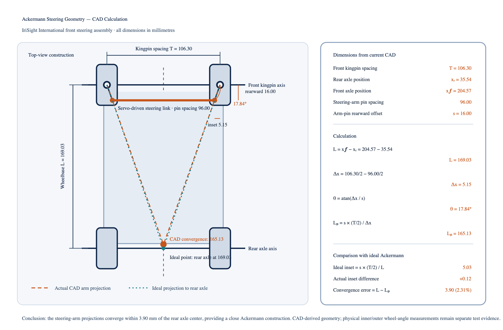

# International mechanical models

This directory contains the editable CAD, printable exports, renders,
engineering drawings, print-setting evidence and mechanical test evidence for
the rebuilt International robot. The former National robot is preserved
separately in [`other/legacy_national/models/`](../other/legacy_national/models/)
and must not be treated as the current design.

## Current competition configuration

| Measurement | Measured value | Rule limit | Remaining margin |
| --- | ---: | ---: | ---: |
| Length | 298 mm | 300 mm | 2 mm |
| Width | 159 mm | 200 mm | 41 mm |
| Height | 223 mm | 300 mm | 77 mm |
| Mass, including all sensors and batteries | 1.28 kg | 1.50 kg | 0.22 kg |

The 2 mm length margin is the most restrictive mechanical constraint. The
cantilevered Hokuyo mount was designed specifically to keep the forward-facing
LiDAR within this envelope.

## Directory map

Each subsystem uses the same basic organization:

```text
models/
├── rear_drivetrain/             motor, coupler and differential support
├── main_chassis/                lower chassis plate and six standoffs
├── front_steering/              Ackermann steering, drawings and evidence
├── electronics_deck/            upper electronics deck and battery enclosure
├── lidar_system/                Hokuyo mount and impact guard
├── camera_system/               three-part panning camera mount
└── rear_tof_jetson_support/     Jetson support and rear ToF platform

Within each subsystem:
├── source/                      editable STEP files
├── printable/                   STL exports
├── renders/                     component and assembly images
├── drawings/                    dimensioned PDF/PNG drawings, where available
├── analysis/                    CAD-derived engineering calculations, where available
├── print_settings/              original slicer project, where available
└── evidence/                    physical failure/test evidence, where available
```

## Mechanical assembly map

```text
International robot
├── Main Chassis Plate V2
│   ├── Rear Drivetrain Module
│   │   ├── JGB37-520 motor
│   │   ├── Integrated Motor–Differential Mount V2
│   │   ├── JGB-to-LEGO Axle Coupler
│   │   ├── LEGO differential and input gears
│   │   └── two LEGO rear axles and wheels
│   └── Ackermann Front Steering Assembly
│       ├── Front Steering Crossmember V2
│       ├── left and right Steering Knuckles V2
│       ├── Servo-Driven Steering Link V1
│       ├── Steering Servo Mount
│       ├── MG996R steering servo
│       └── two LEGO front axles and wheels
└── Six Electronics Deck Standoffs V2
    └── Integrated Electronics Mounting Deck V1
        ├── two-battery slide-in enclosure
        ├── Jetson Orin Nano support features
        ├── Hokuyo UST-30LX Deck Mount
        │   ├── Hokuyo UST-30LX
        │   └── Hokuyo LiDAR Impact Guard
        ├── Servo-Panned Camera Mount
        │   ├── Camera Pan-Servo Tower
        │   ├── Camera Servo Retaining Cover
        │   ├── USB Camera Carrier
        │   ├── DMS-MG90-A 270-degree servo
        │   └── 1 MP Yahboom/Raspbot USB camera
        └── Jetson Support and Rear ToF Sensor Platform
            ├── additional Jetson support
            └── one rear-facing VL53L0X sensor
```

## Current custom-printed parts

All listed parts are printed in PLA. The `Qty` column describes the installed
robot, not the number of historical files in the directory.

| Qty | Current printed part | Revision | Main function | Assets |
| ---: | --- | --- | --- | --- |
| 1 | JGB-to-LEGO Axle Coupler | V1 | Transfers rotation from the JGB D-shaft to the LEGO drivetrain input | [`rear_drivetrain/`](rear_drivetrain/) |
| 1 | Integrated Motor–Differential Mount | V2 | Aligns and supports the drive motor, coupler and LEGO differential | [`rear_drivetrain/`](rear_drivetrain/) |
| 1 | Main Chassis Plate | V2 | Connects the rear drivetrain, front steering and upper structure | [`main_chassis/`](main_chassis/) |
| 6 | Electronics Deck Standoff | V2 | Holds the electronics deck 42 mm above the main chassis | [`main_chassis/`](main_chassis/) |
| 1 | Integrated Electronics Mounting Deck | V1 | Carries the batteries, Jetson, sensors and test electronics | [`electronics_deck/`](electronics_deck/) |
| 1 | Front Steering Crossmember | V2 | Fixed structural base for the steering knuckles | [`front_steering/`](front_steering/) |
| 1 | Left Steering Knuckle | V2 | Pivots the left front wheel and connects it to the steering link | [`front_steering/`](front_steering/) |
| 1 | Right Steering Knuckle | V2 | Pivots the right front wheel and connects it to the steering link | [`front_steering/`](front_steering/) |
| 1 | Servo-Driven Steering Link | V1 | Transfers servo motion to both steering knuckles | [`front_steering/`](front_steering/) |
| 1 | Steering Servo Mount | V1 | Stabilizes the MG996R above the steering assembly | [`front_steering/`](front_steering/) |
| 1 | Hokuyo UST-30LX Deck Mount | V1 | Holds the LiDAR securely while keeping the robot within its length limit | [`lidar_system/`](lidar_system/) |
| 1 | Hokuyo LiDAR Impact Guard | V1 | Intercepts frontal contact below the LiDAR scan plane | [`lidar_system/`](lidar_system/) |
| 1 | Camera Pan-Servo Tower | V1 | Attaches to the deck and supports the camera pan servo | [`camera_system/`](camera_system/) |
| 1 | Camera Servo Retaining Cover | V1 | Closes around and stabilizes the camera servo | [`camera_system/`](camera_system/) |
| 1 | USB Camera Carrier | V1 | Holds the camera board and rotates with the servo horn | [`camera_system/`](camera_system/) |
| 1 | Jetson Support and Rear ToF Sensor Platform | V1 | Supports the Jetson and provides three possible rear ToF positions | [`rear_tof_jetson_support/`](rear_tof_jetson_support/) |

The physical electronics deck has a manually enlarged front opening for servo
clearance. Its STEP and STL preserve the original as-printed V1 geometry.

## Mechanical and electromechanical hardware

| Qty | Component | Mechanical role |
| ---: | --- | --- |
| 1 | JGB37-520, 12 V, 100 RPM motor | Drives both rear wheels through one differential |
| 1 | MG996R servo | Operates the front Ackermann steering linkage |
| 1 | DMS-MG90-A 270-degree servo | Pans the parking-area camera left and right |
| 1 | Hokuyo UST-30LX | Forward-facing LiDAR |
| 1 | 1 MP Yahboom/Raspbot USB camera | Panning parking-area camera |
| 1 installed | VL53L0X | Rear-facing parking-distance sensor |
| 1 | Jetson Orin Nano | Main computer carried by the electronics deck and Jetson support |
| 2 | Robot batteries | Slide into the integrated battery enclosure |

## LEGO drivetrain and wheel inventory

| Qty | Part | Use |
| ---: | --- | --- |
| 4 | 39367pb01 — Wheel 56 × 14 Technic | Two front and two rear wheels |
| 2 | 3708 — Technic Axle 12L, nominally 96 mm | Left and right rear output axles |
| 1 | 65414 — Technic Gear Differential Housing | Rear differential housing |
| 1 | 65413 — Technic Gear 28-Tooth Double Bevel with Pin Hole | Differential ring gear |
| 5 | 6589 — Technic Gear 12-Tooth Bevel | Internal differential gears |
| 1 | 32269 — Technic Gear 20-Tooth Double Bevel | Motor-driven differential input gear |
| 3 total | 87083 — Technic Axle 4L with Stop | One differential input axle and two front wheel axles |
| Multiple | 3713 — Technic Bush | Rear-axle positioning and retention |
| Multiple | 32123 — Technic Bush 1/2 Smooth | Axial retention, including one at each front wheel |

The assembled differential was checked manually: when the unpowered robot's
one rear wheel is rotated, the other rear wheel turns in the opposite direction.

## Drivetrain speed and torque reasoning

The JGB37-520 gearbox output is rated at 100 RPM. Its 20-tooth input gear drives
the differential's 28-tooth ring gear, giving a further reduction of:

```text
reduction = driven teeth / driving teeth = 28 / 20 = 1.40:1
wheel speed = 100 RPM / 1.40 = 71.43 RPM
```

Using the nominal 56 mm wheel diameter, the no-load linear-speed estimate is:

```text
speed = pi × 0.056 m × 71.43 / 60 = 0.209 m/s
```

The same gear pair ideally multiplies the motor gearbox's output torque by
`1.40`; real wheel torque is lower because the bevel gears, differential,
coupler and axle supports have friction. An absolute wheel-torque value is not
claimed because the exact torque curve for the installed 12 V / 100 RPM motor
has not been verified. The calculation is nevertheless useful for the design
choice: the additional reduction sacrifices theoretical speed for greater
wheel torque, while the differential allows the two rear wheels to rotate at
different speeds in a turn.

The 0.209 m/s result is a no-load estimate, not a measured vehicle speed.
Battery voltage, motor load, PWM, tire deformation and field friction all
reduce or vary the real value.

## Confirmed fastener and retention inventory

Only hardware confirmed on the physical robot is listed here.

| Hardware | Confirmed connection |
| --- | --- |
| M2.5 screws | Pass transversely through the integrated V2 steering pivot posts to prevent vertical migration |
| M3 screws | Secure each standoff at the top and bottom; connect the electronics deck, camera tower/cover and rear ToF platform at their documented M3 interfaces |
| M4 screws/fasteners | Secure the Steering Servo Mount and the Hokuyo mount/impact-guard structure |
| Servo-supplied screw | Connects the USB Camera Carrier to the DMS-MG90-A servo horn |
| Original Yahboom camera screws | Retain the camera board in the USB Camera Carrier |
| Screws and nuts | Connect the Rear Drivetrain Module to the Main Chassis Plate |
| LEGO full and half bushes | Limit axle and wheel side-to-side movement |
| Slide-in friction fit | Retains both batteries inside the integrated enclosure without a strap |

## Assembly order and interfaces

1. Assemble the LEGO differential inside the Integrated Motor–Differential
   Mount, then align the JGB motor through the printed axle coupler and input
   gear.
2. Insert the two rear axles, bushes and rear wheels, and verify free
   differential motion before powering the motor.
3. Fasten the Rear Drivetrain Module to the Main Chassis Plate using screws and
   nuts.
4. Build the front steering from the V2 crossmember, V2 knuckles and V1
   steering link. Install the two front wheel axles, wheels and half bushes.
5. Pass M2.5 screws through the V2 steering pivot posts, then install the
   MG996R and Steering Servo Mount.
6. Attach the six V2 standoffs to the Main Chassis Plate with M3 screws and
   secure the electronics deck above them.
7. Slide the batteries into the integrated enclosure and the Jetson into its
   external support channel.
8. Attach the Hokuyo mount, impact guard, panning camera assembly and rear
   ToF/Jetson platform to their deck interfaces.
9. Secure the test electronics and cables, verify that the steering and wheels
   move freely, and check the complete competition dimensions and mass.

## Design evolution

| Date | Mechanical change | Reason and result |
| --- | --- | --- |
| September 7–17, 2026 | Separate Differential Carrier, motor mount and axle coupler developed | Fit corrections were required; the separately supported drivetrain vibrated during operation |
| September 17, 2026 | Integrated Motor–Differential Mount V2 created | Combining the supports made vibration almost imperceptible and reduced unnecessary material |
| September 18–22, 2026 | Initial steering knuckles, crossmember and link developed | Established the first Ackermann steering assembly |
| September 20–October 6, 2026 | Main Chassis Plate refined to V2 | Repositioned drivetrain mounting holes increased ground clearance |
| September 21 and October 6, 2026 | Standoffs changed from the longer V1 to the current 42 mm V2 | Matched the corrected chassis height while retaining the same support function |
| September 22, 2026 | Steering Servo Mount completed | Reduced MG996R movement and vibration |
| September 24, 2026 | Integrated Electronics Mounting Deck completed | Combined battery, Jetson and sensor support in one print; its servo opening was enlarged manually during installation |
| October 6, 2026 | Hokuyo LiDAR Impact Guard completed | Protected the forward LiDAR during accidental contact without blocking its scan |
| October 13, 2026 | Rear drivetrain V2 refined | Added space for an extra bush after the right rear axle slid outward at high speed |
| October 30, 2026 | Front Steering Crossmember V2 completed | A stronger, bulkier body replaced the V1 crossmember after vehicle loading caused bending |
| November 2–10, 2026 | LiDAR deck mount and three-part panning camera mount completed | Kept the robot within the length limit and added camera panning for parking-area mapping |
| November 3–12, 2026 | Stronger steering-pin print and temporary screw tests | Stronger pins resisted breakage but migrated vertically; the temporary screw approach did not solve it permanently |
| November 14, 2026 | Jetson Support and Rear ToF Sensor Platform completed | Added Jetson support and three possible rear-sensor positions; the center position is currently used |
| November 21, 2026 | Steering Knuckles V2 completed | Integrated longer solid pivots with transverse M2.5 retention to prevent vertical drift |

The broken-pin evidence is preserved at
[`front_steering/evidence/broken_knuckle_pin_failure.jpeg`](front_steering/evidence/broken_knuckle_pin_failure.jpeg).

## Ackermann geometry calculation

The current steering geometry was checked directly from the final chassis and
front-steering CAD rather than inferred from the rendered assembly.

<div align="center">
  
</div>

| CAD quantity | Value |
| --- | ---: |
| Wheelbase, `L` | 169.03 mm |
| Front kingpin spacing, `T` | 106.30 mm |
| Steering-link pin spacing | 96.00 mm |
| Arm-pin rearward offset | 16.00 mm |
| Actual arm-pin inset | 5.15 mm |
| Ideal arm-pin inset | 5.03 mm |
| Calculated steering-arm angle | 17.84° |
| Projected convergence behind the front axle | 165.13 mm |
| Convergence offset from rear-axle center | 3.90 mm, or 2.31% of wheelbase |

The actual inset differs from the ideal construction by 0.12 mm, so the design
is documented as a **close Ackermann construction**. This is CAD-derived
geometry evidence. Physical inner- and outer-wheel-angle measurements remain
a separate final-configuration test.

- [Full-resolution calculation PNG](front_steering/analysis/ackermann_geometry_calculation.png)
- [Editable calculation SVG](front_steering/analysis/ackermann_geometry_calculation.svg)

## Verified steering strength-test print profile

The original November 3 V1 knuckle strength-test project is preserved at
[`front_steering/print_settings/knuckle_v1_strength_test_2026-11-03.3mf`](front_steering/print_settings/knuckle_v1_strength_test_2026-11-03.3mf).
These settings are verified for that test project and are not presented as the
universal profile for every robot part.

| Setting | Value |
| --- | --- |
| Slicer | Anycubic Slicer Next 1.4.1.1 |
| Printer | Anycubic Kobra 3 |
| Nozzle | 0.4 mm brass |
| Material | 1.75 mm PLA |
| Layer height | 0.16 mm |
| Wall loops | 6 |
| Sparse infill | 100%, zig-zag |
| Top/bottom shell layers | 5 / 5 |
| Nozzle temperature | 225 °C |
| Bed temperature | 60 °C |
| Support | Automatic tree support, build plate only |

## Drawings and manufacturing files

Dimensioned drawings currently cover:

| Subsystem | Drawing | Content |
| --- | --- | --- |
| Main chassis | [`main_chassis_plate_v2_drawing.pdf`](main_chassis/drawings/main_chassis_plate_v2_drawing.pdf) | Main Chassis Plate V2 |
| Main chassis | [`electronics_deck_standoff_v2_drawing.pdf`](main_chassis/drawings/electronics_deck_standoff_v2_drawing.pdf) | Electronics Deck Standoff V2 |
| Rear drivetrain | [`integrated_motor_differential_mount_v2_drawing.pdf`](rear_drivetrain/drawings/integrated_motor_differential_mount_v2_drawing.pdf) | Integrated Motor–Differential Mount V2 |
| Rear drivetrain | [`jgb_to_lego_axle_coupler_v1_drawing.pdf`](rear_drivetrain/drawings/jgb_to_lego_axle_coupler_v1_drawing.pdf) | JGB-to-LEGO Axle Coupler V1: D-bore and LEGO cross-axle hole in section |
| Electronics deck | [`integrated_electronics_mounting_deck_v1_drawing.pdf`](electronics_deck/drawings/integrated_electronics_mounting_deck_v1_drawing.pdf) | Integrated Electronics Mounting Deck V1, with the role of each mounting hole |
| Rear ToF and Jetson support | [`jetson_support_rear_tof_sensor_platform_drawing.pdf`](rear_tof_jetson_support/drawings/jetson_support_rear_tof_sensor_platform_drawing.pdf) | Jetson Support and Rear ToF Sensor Platform |
| Front steering | [`front_steering_assembly_v2_drawing.pdf`](front_steering/drawings/front_steering_assembly_v2_drawing.pdf) | Ackermann Front Steering Assembly: parts list, pin spacing and the 17.84° steering-arm angle |
| Front steering | [`steering_knuckles_v2_drawing.pdf`](front_steering/drawings/steering_knuckles_v2_drawing.pdf) | Left and Right Steering Knuckles V2 |
| Front steering | [`crossmember_and_steering_link_drawing.pdf`](front_steering/drawings/crossmember_and_steering_link_drawing.pdf) | Front Steering Crossmember V2 and Servo-Driven Steering Link V1 |
| Front steering | [`steering_servo_mount_drawing.pdf`](front_steering/drawings/steering_servo_mount_drawing.pdf) | Steering Servo Mount |
| LiDAR system | [`lidar_mount_and_impact_guard_drawing.pdf`](lidar_system/drawings/lidar_mount_and_impact_guard_drawing.pdf) | Hokuyo UST-30LX Deck Mount and Hokuyo LiDAR Impact Guard |
| Camera system | [`servo_panned_camera_mount_drawing.pdf`](camera_system/drawings/servo_panned_camera_mount_drawing.pdf) | Servo-Panned Camera Mount assembly, plus its three printed parts |

Every dimension and hole position on these sheets is read from the STEP file.
Each PDF has matching 300 dpi PNG sheets in the same folder. The deck drawing
shows the deck as designed in CAD; on the robot, the front servo opening was
enlarged by hand during installation, as described above.

The drawings are stored beside their subsystem under `drawings/`. STEP files
are the editable interchange source, while STL files are the direct printable
exports. Assemblies and historical V1 files are retained to show the design
process; the `Current custom-printed parts` table above identifies the parts
installed on the International robot.
