# IriSight Engineering Journal

## WRO Future Engineers 2026 — International Robot

**Team:** IriSight  
**Institution:** AUPP  
**Last updated:** 23 November 2026  
**CAD:** Autodesk Fusion 360  
**Manufacturing:** Anycubic Kobra 3, 0.4 mm nozzle, PLA


> This manuscript describes the current International robot. The National
> project is preserved separately in `other/legacy_national/` and is used here
> only when explaining the evidence that led to a redesign. Where no formal
> physical test record exists, the journal says so instead of estimating a
> result.

---

## 1. Final robot at a glance

IriSight is a four-wheel autonomous vehicle built around an NVIDIA Jetson Orin
Nano and an ESP32. A Hokuyo UST-30LX LiDAR supplies the main geometric view of
the field, a BNO055 supplies heading, a 1 MP USB camera classifies coloured
traffic pillars, and a rear VL53L0X supports parking. The vehicle uses one rear
JGB37-520 drive motor through a LEGO differential and an MG996R servo for the
front Ackermann steering mechanism.

<p align="center">
  
</p>

### Final measured envelope

| Property | Measured | Rule limit | Margin |
| --- | ---: | ---: | ---: |
| Length | 298 mm | 300 mm | 2 mm |
| Width | 159 mm | 200 mm | 41 mm |
| Height | 223 mm | 300 mm | 77 mm |
| Mass, including sensors and batteries | 1.28 kg | 1.50 kg | 0.22 kg |

The 2 mm length margin strongly influenced the cantilevered LiDAR mount and
front guard design. These values were measured on the assembled robot.

### Current subsystem map

| Function | Current solution |
| --- | --- |
| Main computer | Jetson Orin Nano, JetPack SDK, 15 W mode |
| Low-level controller | ESP32-based board |
| Rear drive | One JGB37-520, 12 V, 100 RPM, LEGO differential |
| Steering | MG996R with printed Ackermann assembly |
| Main ranging | Hokuyo UST-30LX LiDAR |
| Heading | BNO055 IMU |
| Vision | 1 MP USB camera on 270-degree pan servo |
| Rear parking range | One center-mounted VL53L0X |
| Custom structure | Fusion 360 parts printed in PLA |

---

## 2. Why we rebuilt the robot

The National robot gave us a working autonomous platform, but it also revealed
four limitations that were difficult to solve independently.

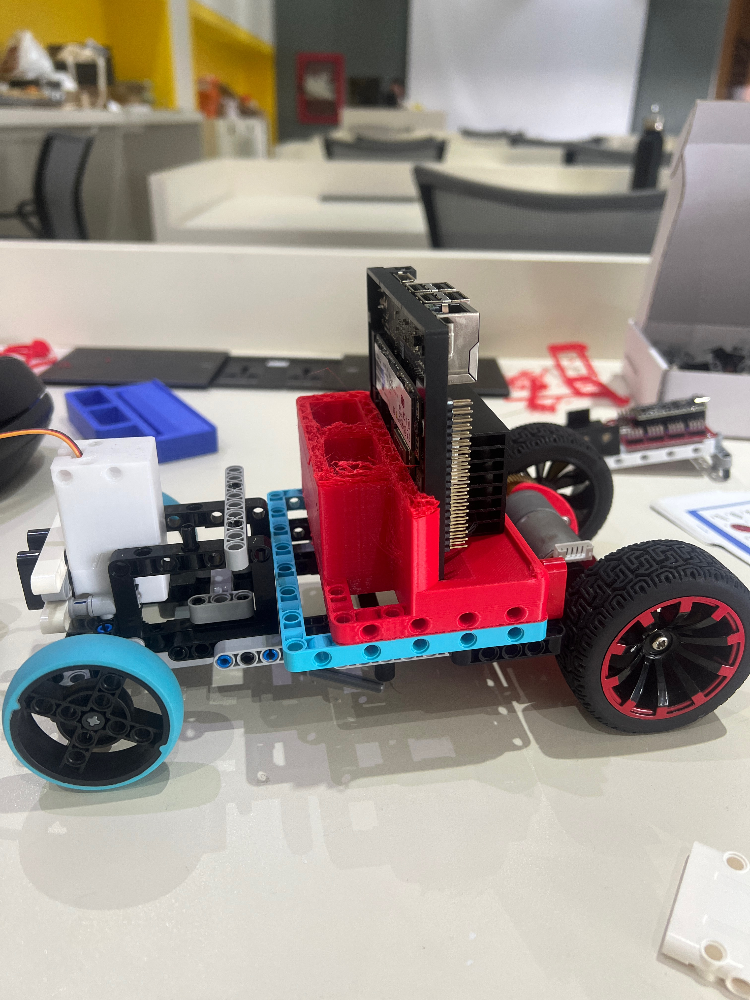

First, our Intel RealSense D455 developed noisy sensing on its left side. This
made the main perception source less dependable. Second, the parallel steering
geometry did not give us the accuracy and turning behavior we wanted. Third,
the old rear-wheel system could become stuck on the field at motor commands
below approximately 100/255. When we lifted the rear of the robot, the motor
and wheels rotated normally, showing that the failure occurred under load at
the wheel–field interface rather than being a simple disconnected motor.

The National rear system also used non-LEGO wheels, steel axles and steel gears
from another vehicle kit. At the same time, many of our repeatedly used LEGO
parts had become damaged or scarce. If another failure occurred, we had little
replacement capacity for testing.

We therefore chose to rebuild the mechanical platform rather than continue
adding corrections to it. Our International design goals were:

1. use the same replaceable LEGO wheel type at all four corners;
2. create a compact rear drivetrain around a larger JGB motor;
3. replace parallel steering with a rigid Ackermann-style assembly;
4. separate the lower structural chassis from an upper electronics deck;
5. protect the LiDAR and keep the complete robot inside the size limit; and
6. preserve every design iteration so that failures and decisions could be
   reproduced from the repository.

---

## 3. Our engineering method

For most printed components, design and testing happened on the same day. We
measured the real component, created or adjusted the Fusion 360 model, printed
the part, installed it, and corrected the model immediately if the fit or
behavior was wrong. We repeated that loop until the interface was usable.

```text
Observe a problem
        ↓
Measure the real interface
        ↓
Model in Fusion 360
        ↓
Print in PLA and assemble
        ↓
Test under robot load
        ↓
Keep, revise, or reject the design
```

The important part of this method was testing the full assembly. A part could
fit correctly by itself but fail after vibration, robot weight or repeated
turning was added. The rear-mount vibration and steering-pivot drift described
below were both found only after assembly testing.

### Mechanical development timeline

| Date | Main development |
| --- | --- |
| 7–17 Sep 2026 | Rear differential carrier, motor mount and shaft coupler |
| 17 Sep | Integrated Motor–Differential Mount V2 |
| 18–22 Sep | First steering knuckles, crossmember and link |
| 20 Sep–6 Oct | Main Chassis Plate and ground-clearance refinement |
| 21 Sep–6 Oct | Electronics Deck Standoff V1 and shorter V2 |
| 22 Sep | Steering Servo Mount |
| 24 Sep | Integrated Electronics Mounting Deck |
| 6 Oct | Hokuyo LiDAR Impact Guard |
| 13 Oct | Rear-axle retention refinement |
| 30 Oct | Front Steering Crossmember V2 |
| 2 Nov | Hokuyo UST-30LX Deck Mount |
| 2–10 Nov | Servo-Panned Camera Mount |
| 3–21 Nov | Steering strength, drift and retained-pivot revisions |
| 14 Nov | Jetson Support and Rear ToF Sensor Platform |

---

## 4. Rear Drivetrain Module

### 4.1 Design decision

We replaced the National steel-axle rear system with the same LEGO wheel used
at the front. This gave us one wheel standard across the robot and allowed us
to use LEGO axles and a LEGO differential. One JGB37-520 12 V, 100 RPM motor
drives both rear wheels through the differential, so both sides receive the
same input speed while still being able to rotate at different speeds in a
turn.

The working differential was checked manually: when one rear wheel is turned,
the opposite wheel rotates in the opposite direction.

### 4.2 JGB-to-LEGO Axle Coupler — 10–17 September

The JGB motor has a D-shaped output shaft, while the LEGO drivetrain needs a
cross-axle interface. We designed a printed **JGB-to-LEGO Axle Coupler** to
translate between them.

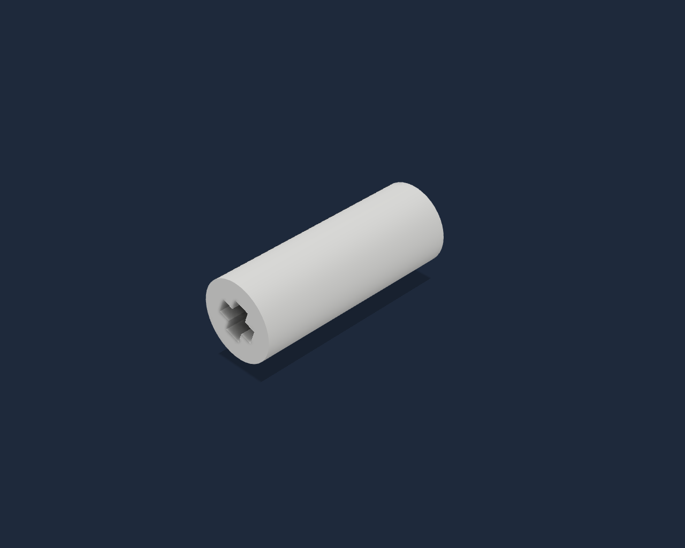

The main failure mode was fit. Early prints were either too tight to install or
too loose to transmit motion reliably. We repeatedly corrected the measured
D-profile until the coupler fitted the motor shaft. The working D-shaft model
uses a 3.2 mm radius and a 3.52 mm flat-face measurement. These dimensions
record the CAD used by the team; they are not intended as a general JGB motor
standard.

### 4.3 Separate V1 parts — 7–17 September

The first drivetrain arrangement used three printed parts:

- Differential Carrier V1, developed from 7–15 September;
- JGB Motor Mount V1, developed from 15–17 September; and
- the coupler, developed from 10–17 September.

The separate motor mount and differential carrier worked when tested together,
but we observed substantial vibration through the coupler and drivetrain. The
problem was not the differential principle; it was the relative movement
between separately supported components.

### 4.4 Integrated V2 — 17 September

We responded by joining the motor support and differential carrier into one
printed entity: the **Integrated Motor–Differential Mount V2**. The coupler
remained inside, between the motor and the bevel input gear.

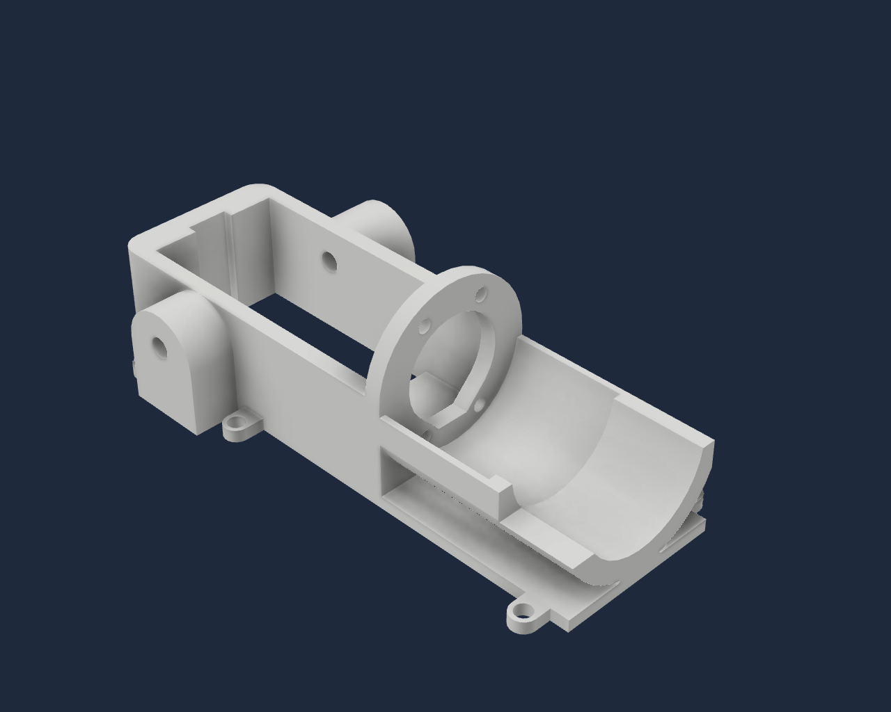

This common structure reduced the vibration to almost zero because the motor
and differential could no longer move independently. Material was also removed
digitally from the original carrier geometry before printing, rather than
physically cutting an existing printed part.

### 4.5 Axle-retention refinement — 13 October

During higher-speed running, the right rear axle could slide outward. We
retained V2 as the only published integrated version but refined it on 13
October to leave a location for an additional Technic Bush, part 3713. The bush
limits axial travel and makes the axle less likely to escape.

### 4.6 Drivetrain bill of materials

| Part | Number | Use |
| --- | --- | --- |
| Wheel 56 × 14 Technic | 39367pb01 | all four wheels |
| Axle 12L | 3708 | left and right rear axles |
| Differential Housing | 65414 | differential body |
| Gear 28 Tooth Double Bevel | 65413 | differential ring gear |
| Gear 12 Tooth Bevel | 6589 | internal differential gears |
| Gear 20 Tooth Double Bevel | 32269 | motor-side input |
| Axle 4L with Stop | 87083 | bevel input axle |
| Technic Bush / Half Bush | 3713 / 32123 | prevent axial drift |

### 4.7 Speed and torque reasoning

The 100 RPM gearbox output drives a 20-tooth gear, which turns the
differential's 28-tooth ring gear. This adds a `28/20 = 1.40:1` reduction:

```text
wheel speed = 100 RPM × 20 / 28 = 71.43 RPM
no-load vehicle speed = pi × 0.056 m × 71.43 / 60 = 0.209 m/s
```

Ideally, the same gear pair multiplies the motor gearbox's output torque by
1.40. Actual torque is lower because of losses through the bevel gears,
differential, coupler and axle supports. We do not claim an absolute wheel
torque because the exact torque curve for the installed 12 V / 100 RPM motor
has not been verified. Likewise, 0.209 m/s is a theoretical no-load value;
real speed depends on PWM, battery voltage, robot load and field friction.

The engineering trade-off is still clear: the 28:20 reduction gives up some
theoretical speed for greater wheel torque, while the differential prevents
the two driven wheels from being forced to the same speed in a turn.

**Decision:** keep the integrated mount. It solved the major V1 vibration and
gave the rear drivetrain one reproducible assembly. The CAD, drawings and
printable files are in [`models/rear_drivetrain/`](../../../models/rear_drivetrain/).

---

## 5. Main Chassis Plate

The **Main Chassis Plate** is the lower structural layer. It holds the rear
drivetrain and wheel structure, accepts the steering crossmember at the front,
and provides the base for the upper electronics system.

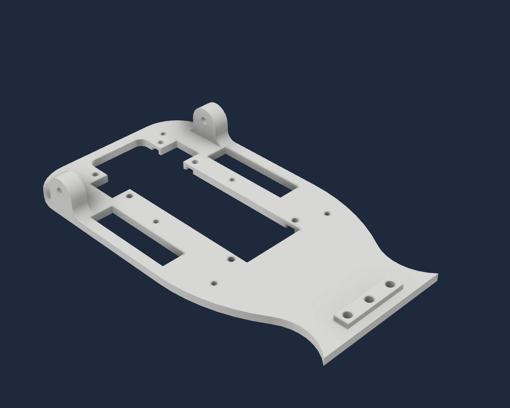

### V1 problem — 20 September onward

The first plate was printable and structurally usable, but it positioned the
robot too close to the ground. Insufficient ground clearance risked contact
with the field and did not leave enough space for the mechanisms below the
upper deck.

### V2 refinement — completed 6 October

We increased the chassis height and moved the mounting holes for the Rear
Drivetrain Module. Only two physical chassis prints were needed; the first
revealed the clearance problem, and the second was usable.

The drivetrain and chassis are joined with screws and nuts. Exact fastener
details that have not been physically reconfirmed are intentionally excluded
from the public bill of materials.

**Decision:** retain Main Chassis Plate V2 as the International lower chassis.
Its corrected height also allowed us to shorten the electronics-deck
standoffs later.

---

## 6. Ackermann Front Steering Assembly

### 6.1 Why the geometry changed

The National robot used parallel steering. For the International rebuild, we
wanted the inner front wheel to turn more sharply than the outer front wheel,
reducing scrub and improving the vehicle's turning path. We therefore created
a four-part printed system around an Ackermann-style linkage:

- left Steering Knuckle;
- right Steering Knuckle;
- Front Steering Crossmember; and
- Servo-Driven Steering Link.

The MG996R servo moves the central link through its horn. The link connects the
two knuckles, while each knuckle holds an Axle 4L with Stop for the front wheel.

### 6.2 V1 development — 18–22 September

The left and right knuckles were developed from 18–20 September. The first
crossmember and steering link followed from 20–22 September.

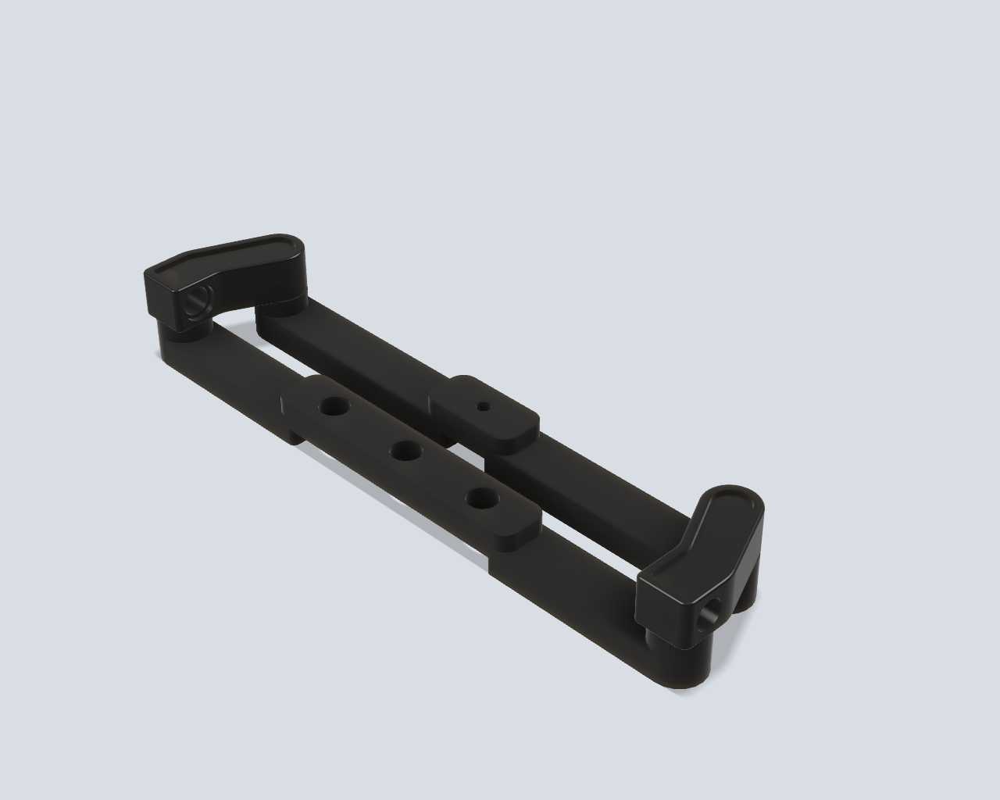

The knuckles rotated on 3D-printed pivots shaped to mimic LEGO Technic
Connector Pin 2780. The pivots were printed as part of the assembly rather than
using genuine LEGO pins, because they had to integrate into the custom
knuckle/crossmember interface.

### 6.3 Printed-pin breakage

Repeated tests showed that the printed pins were not strong enough for the
robot's mass and steering load. The pivot could break at the interface.

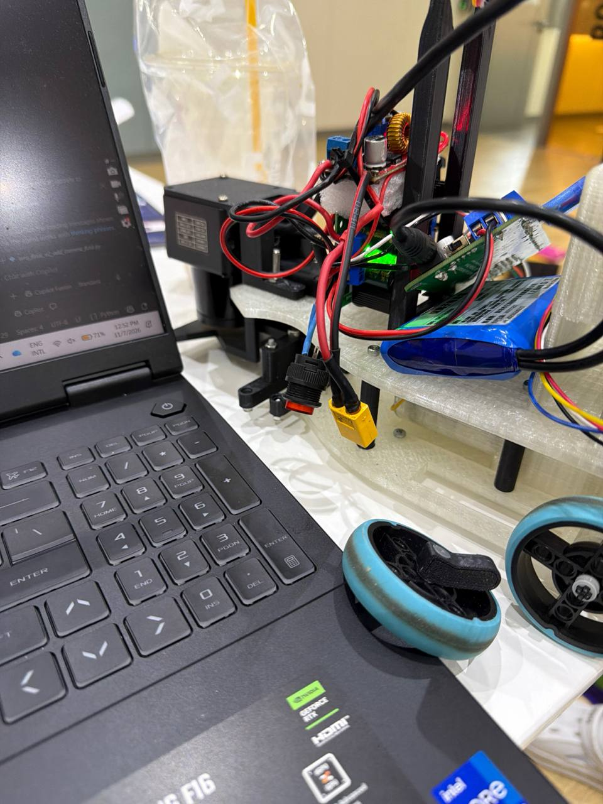

On 3 November we tested stronger slicer settings using the Anycubic project
stored in `models/front_steering/print_settings/`. The stronger print reduced
breakage, but it exposed a second failure mode rather than fully solving the
joint.

### 6.4 Vertical drift — 10 November

After repeated steering tests, the knuckle could climb vertically along its
pivot. This changed the wheel position and therefore disturbed the steering
configuration assumed by the control code. On 11–12 November we tried placing
a screw into the printed-pin hole. It helped temporarily but did not provide
permanent axial retention.

This was an important design lesson: increasing material strength does not
solve a joint whose motion is insufficiently constrained.

### 6.5 Crossmember V2 — 30 October

The first crossmember could bend under the completed robot's weight. We created
a thicker, more robust **Front Steering Crossmember V2** on 30 October. This
improved structural stiffness and reduced changes in wheel alignment caused by
the chassis load.

### 6.6 Retained-pivot Knuckles V2 — 21 November

For the final redesign, we removed the separate LEGO-inspired pin geometry and
extended the knuckle pivot. Horizontal M2.5 screws now retain each pivot and
prevent it from drifting vertically.

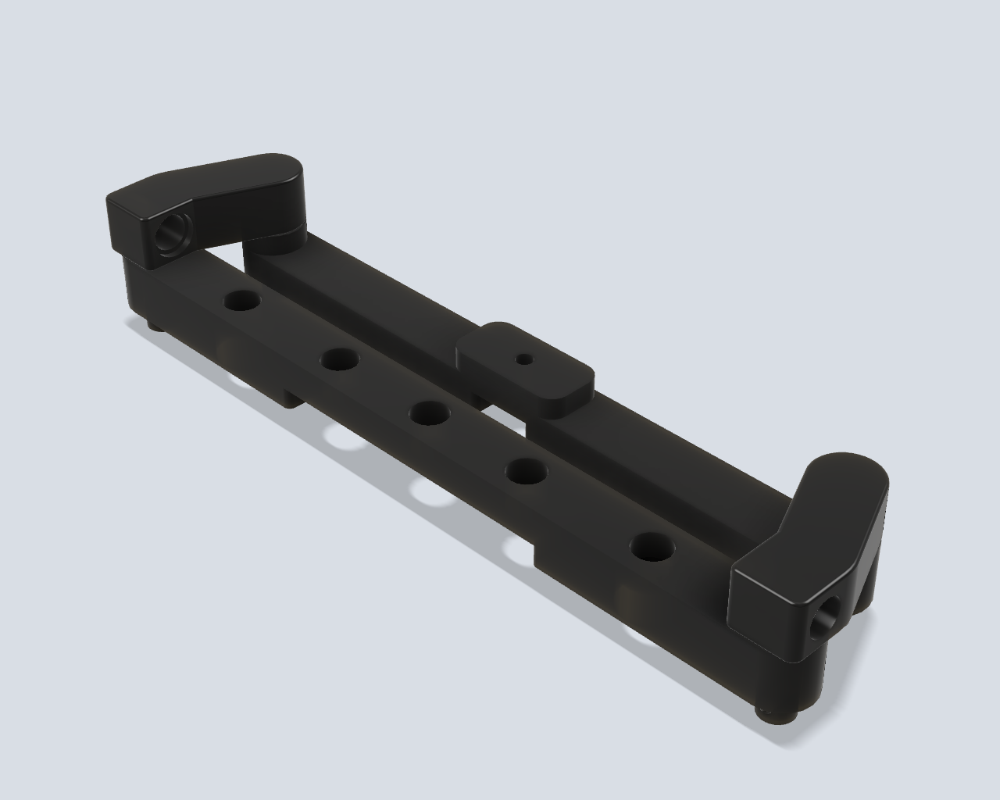

This is the current version, as used on the robot, and it has performed
better than V1 in team testing. It was completed after the available
demonstration videos, so no numerical success rate is reported for it here.

**Decision:** use Crossmember V2 and Knuckles V2. The sequence from broken
pivot, to stronger print, to vertical drift, to positive screw retention shows
why the final change was a geometry correction rather than only a slicer
correction.

### 6.7 CAD geometry check

We checked the steering-arm layout against the wheelbase using dimensions from
the current CAD. The Main Chassis Plate gives a 169.03 mm wheelbase. The front
assembly gives 106.30 mm between kingpins, 96.00 mm between the steering-link
pins, and a 16.00 mm rearward arm-pin offset.

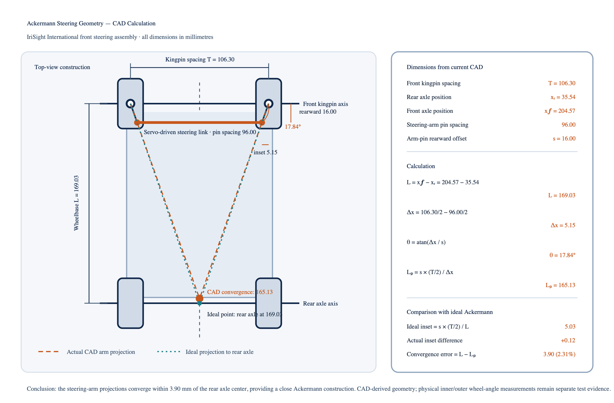

The link-pin spacing creates a 5.15 mm inset at each side and a calculated
steering-arm angle of 17.84°. Projecting the two steering arms rearward makes
them meet 165.13 mm behind the front axle. The ideal point is the rear-axle
center at 169.03 mm, leaving a 3.90 mm difference, or 2.31% of the wheelbase.

The ideal inset for these CAD dimensions is 5.03 mm, only 0.12 mm from the
actual value. We therefore describe the result as a **close Ackermann
construction**, not mathematically perfect Ackermann. This calculation is
design evidence from the CAD. The MATLAB linkage model in
[`matlab_simulink/`](../../../matlab_simulink/README.md) solves the full
mechanism at every steering angle and shows that it gives 56–70 % of the ideal
inner–outer wheel difference.

---

## 7. Steering Servo Mount — 22 September

Mounting the MG996R directly would allow the servo body to move and become
imbalanced under vibration, which would affect the repeatability of commanded
steering angles. We therefore designed a separate **Steering Servo Mount**.

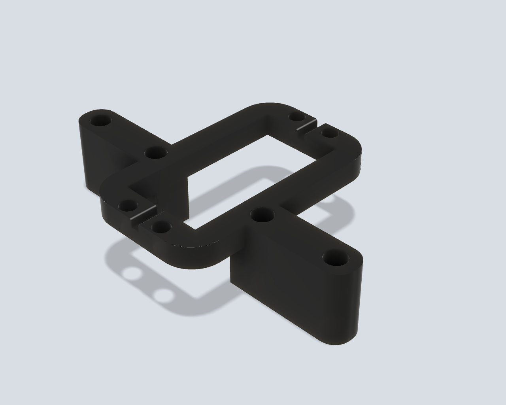

The servo passes through the center opening and is secured through four central
holes. The outer arm mounting points connect through the additional holes in
the latest crossmember, while the inner connection shares the crossmember and
Main Chassis Plate interface. The confirmed fastener family is M4; unverified
lengths are not published.

Only one CAD version was required. The design was made and tested on 22
September and has been sufficient for the current assembly.

---

## 8. Electronics Deck Standoffs

Six identical standoffs connect the Main Chassis Plate to the upper electronics
deck. They create clearance for the steering servo, rear drivetrain and wiring
while making the two-layer structure rigid.

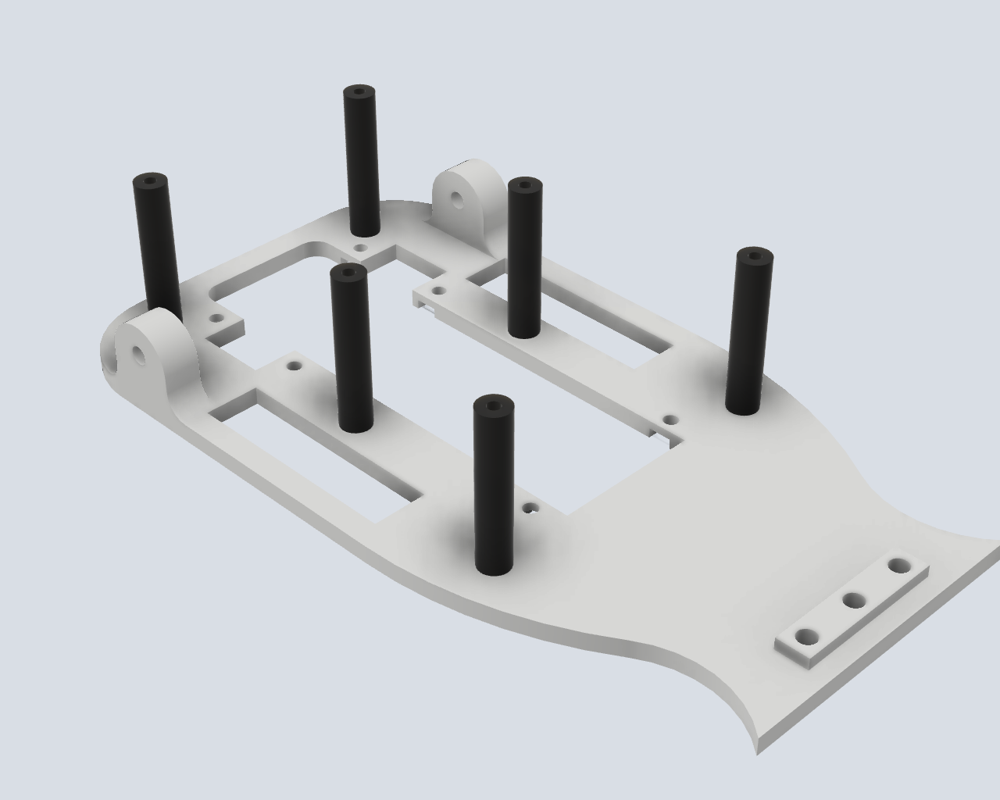

### V1 — 21 September

Standoff V1 was longer because the original Main Chassis Plate placed the robot
too near the ground. At that stage, the greater deck separation was needed to
fit the mechanical system.

### V2 — 6 October

After the chassis ground-clearance correction, the original standoffs were no
longer necessary. We shortened the current version to 42 mm. M3 screws secure
each standoff at both top and bottom.

**Decision:** use six 42 mm Standoffs V2. The change was a direct consequence
of revising the lower chassis, showing how one dimensional correction affects
the complete vehicle stack.

---

## 9. Integrated Electronics Mounting Deck — 24 September

The one-piece **Integrated Electronics Mounting Deck V1** is the upper
structural layer. It contains a slide-in enclosure for the batteries, supports
the Jetson externally, and provides mounting positions for the camera, LiDAR,
rear ToF platform and experimental electronics.

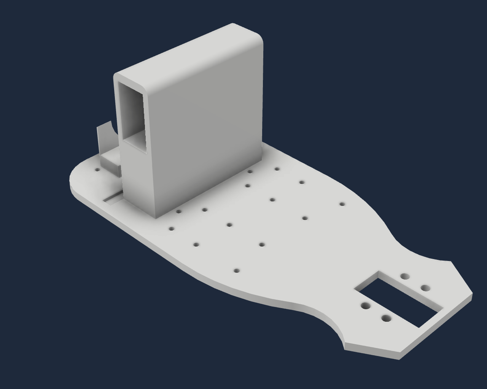

The deck printed successfully on the first version and has not required a new
digital revision. However, installation revealed that the front rectangular
opening was slightly too small for the steering servo. We manually enlarged
the front of the opening on the physical print.

This means the installed deck differs slightly from the uploaded CAD. We keep
the original V1 file because no second digital version was produced, and we
state the post-print modification instead of presenting the CAD as an exact
digital twin.

The deck includes spare holes so that components can be moved, and some
boards are held with zip ties for the same reason.

---

## 10. Hokuyo LiDAR system

### 10.1 Hokuyo LiDAR Impact Guard — 6 October

The Hokuyo is a critical and exposed sensor. We added a one-piece **Hokuyo
LiDAR Impact Guard** after considering the risk of the robot striking a wall or
physical object.

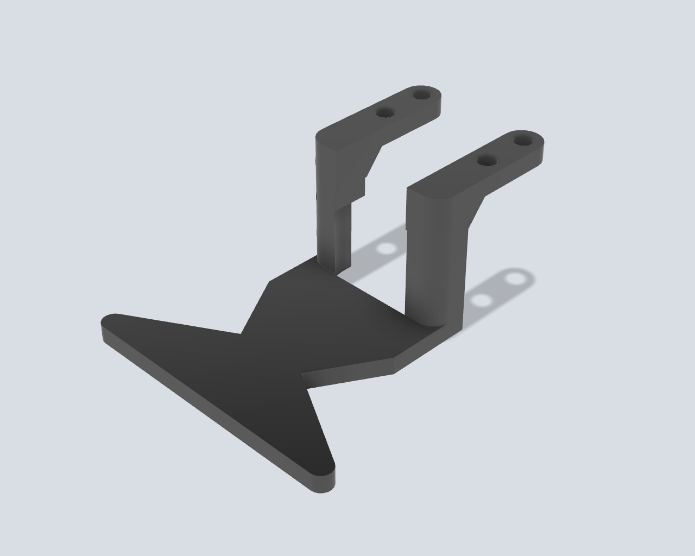

The two nearest holes mount the guard to the LiDAR/electronics-deck structure.
The farther access holes allow a screwdriver to reach the steering fasteners
below, so protection does not make the robot unserviceable. The guard sits
below the active scan plane and was checked while the LiDAR was operating; no
scan interference was observed.

The guard has protected the sensor during multiple accidental contacts. It is
therefore not only a precautionary CAD feature but a part with observed value
during testing.

### 10.2 Hokuyo UST-30LX Deck Mount — 2 November

Mounting the LiDAR directly would have pushed the vehicle beyond its length
limit. The **Hokuyo UST-30LX Deck Mount** uses cantilevered geometry so the
sensor fits inside the 298 mm final envelope.

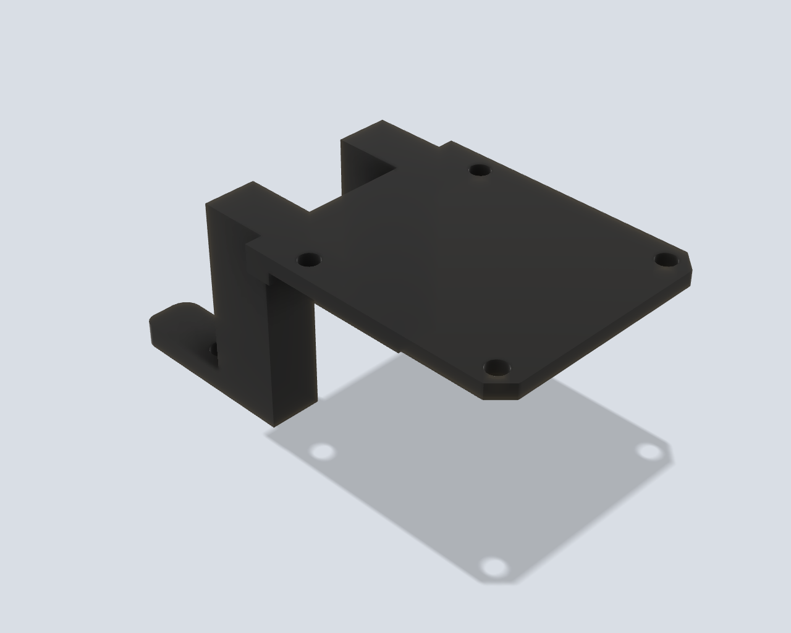

The Hokuyo slides into the mount and is retained through the two farthest
positions with M4 screws. The mount shares its deck-side attachment with the
impact guard. The current version has performed well and did not require an
additional revision.

**Decision:** retain both mount and guard. Together they solve two different
constraints: legal packaging and physical sensor protection.

---

## 11. Servo-Panned Camera Mount — 2–10 November

The 1 MP USB camera is taken from a Yahboom/Raspbot V2 system. Because it is
small and light, we mounted it on a DMS-MG90-A 270-degree servo for left/right
viewing from the parking area.

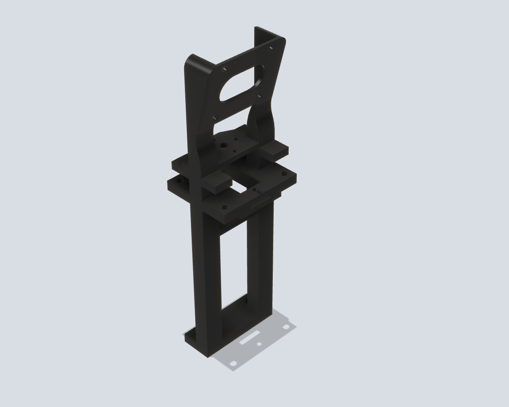

The assembly has three printed parts:

1. **Camera Pan Servo Tower** — screws to the electronics deck with M3 hardware
   and holds the servo;
2. **Camera Servo Retaining Cover** — closes around the servo to reduce body
   movement and vibration; and
3. **USB Camera Carrier** — attaches to the servo horn and is the only moving
   printed part.

The camera's original small fasteners were reused in the carrier. The servo
pack supplied the horn screws.

The CAD worked without a geometry revision. The main difficulty was
manufacturing: the printer repeatedly stopped feeding filament during a print
because it did not recognize one ACE Pro 2 unit. We reconnected and
reconfigured the system several times, then bypassed the unreliable feed path
by using the spare ACE Pro 2. The successful print confirmed that the failure
was in the material-feed setup rather than the part geometry.

The planned Obstacle Challenge workflow uses three stationary viewing angles
to observe the parking-area field, combine colour/object observations, and
store a frozen pillar map in JSON before the robot starts driving. The mount
makes that workflow physically possible. Automatic servo scanning and JSON
generation are still to be integrated into the challenge programs, so this
journal distinguishes the mechanical capability from the unfinished software
step.

At explanation level, the intended perception pipeline is dynamic rather than
one fixed colour threshold. YOLO first localizes candidate pillars in each of
the three views. HSV colour evidence from the current frames then checks the
red/green interpretation under the observed lighting. Repeated observations
are fused by bearing and confidence, converted into track sections, and frozen
as a JSON map before motion begins. This reduces the effect of vibration,
changing camera position and intermittent cabling during the driving run. It
is the target mapping architecture; the present challenge programs consume the
JSON map but do not yet implement the complete scanner and generator.

---

## 12. Jetson Support and Rear ToF Sensor Platform — 14 November

The final reported printed component is the one-piece **Jetson Support and Rear
ToF Sensor Platform**.

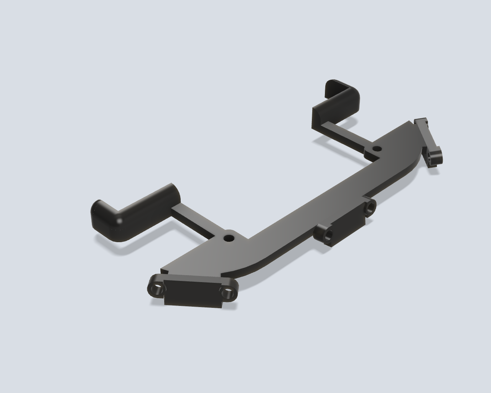

It serves two purposes:

- it adds structural support for the Jetson; and
- it provides three possible rear VL53L0X mounting positions.

Only the center rear-facing VL53L0X is currently installed. The side positions
were included because the design was made while sensor placement was still
being tested. Small screws secure the current sensor; exact unconfirmed sizes
are left out of the public record.

This is the current version, as used on the robot; one print has been made.

---

## 13. Final mechanical integration

The complete robot uses two structural levels. The Main Chassis Plate supports
the rear drivetrain and steering. Six standoffs carry the Integrated
Electronics Mounting Deck, which then supports the Jetson, batteries, LiDAR,
camera and rear ToF system.

<p align="center">
  
</p>

### Current assembly sequence

1. Assemble the LEGO differential, rear axles, gears and bushes inside the
   Integrated Motor–Differential Mount.
2. Fit the JGB-to-LEGO coupler between the JGB37-520 shaft and bevel input.
3. Secure the Rear Drivetrain Module to the Main Chassis Plate.
4. Assemble Crossmember V2, Steering Knuckles V2, steering link and wheels.
5. Install the MG996R through the Steering Servo Mount and connect its horn to
   the steering link.
6. Install all six 42 mm standoffs with M3 top and bottom screws.
7. Fit the Integrated Electronics Mounting Deck.
8. Install the LiDAR mount and impact guard, camera pan assembly, Jetson support
   and center rear ToF sensor.
9. Install batteries, Jetson, ESP32/control electronics and wiring.
10. Check wheel freedom, steering retention, LiDAR scan clearance and the final
    300 mm length limit before powered testing.

### Manufacturing lessons

- A correct static fit is not enough; vibration and repeated-load tests must
  be performed on the complete assembly.
- Stronger print settings cannot correct an under-constrained joint.
- Keeping motor and differential references in one printed structure reduced
  vibration more effectively than tuning separate mounts.
- Physical post-processing must be recorded when the installed print no
  longer exactly matches its CAD.
- Packaging should be checked against the full legal envelope early. The
  current vehicle has only 2 mm spare length.

### Mechanical evidence boundary

The CAD source, STL files, renders and principal drawings are organized under
[`models/`](../../../models/README.md). The current six-view photographs are
under [`v-photos/`](../../../v-photos/README.md). The final steering revision
is newer than the available running videos.

---

## 14. Where the other subsystems are documented

| Subsystem | Documentation |
| --- | --- |
| Two-battery power distribution, signal wiring and power budget | [`schemes/`](../../../schemes/README.md) |
| Jetson–ESP32 software architecture and setup | [`src/`](../../../src/README.md) |
| Open and Obstacle Challenge strategy, including parking | [`src/main_controller/`](../../../src/main_controller/README.md) |
| YOLOv8n training settings and validation results | [`src/ai_model/`](../../../src/ai_model/README.md) |
| Steering-linkage and Open Challenge models | [`matlab_simulink/`](../../../matlab_simulink/README.md) |
| Test procedures and evidence | [`other/testing/`](../../testing/README.md) |
