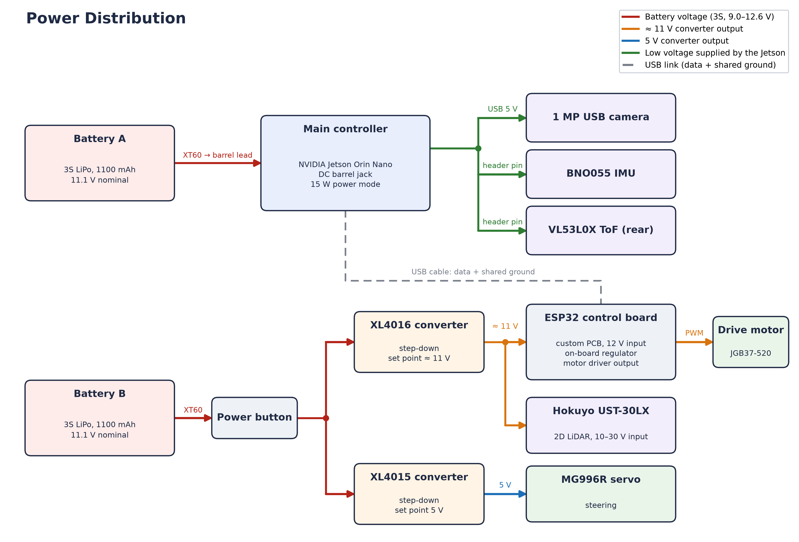
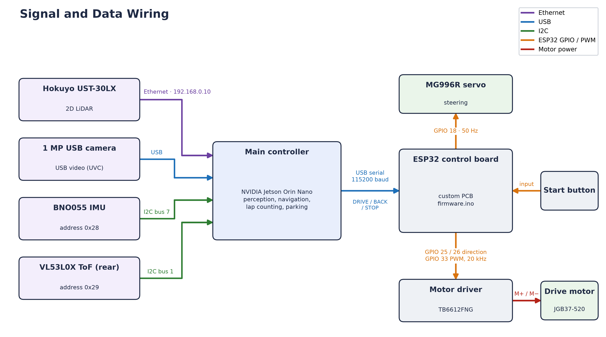
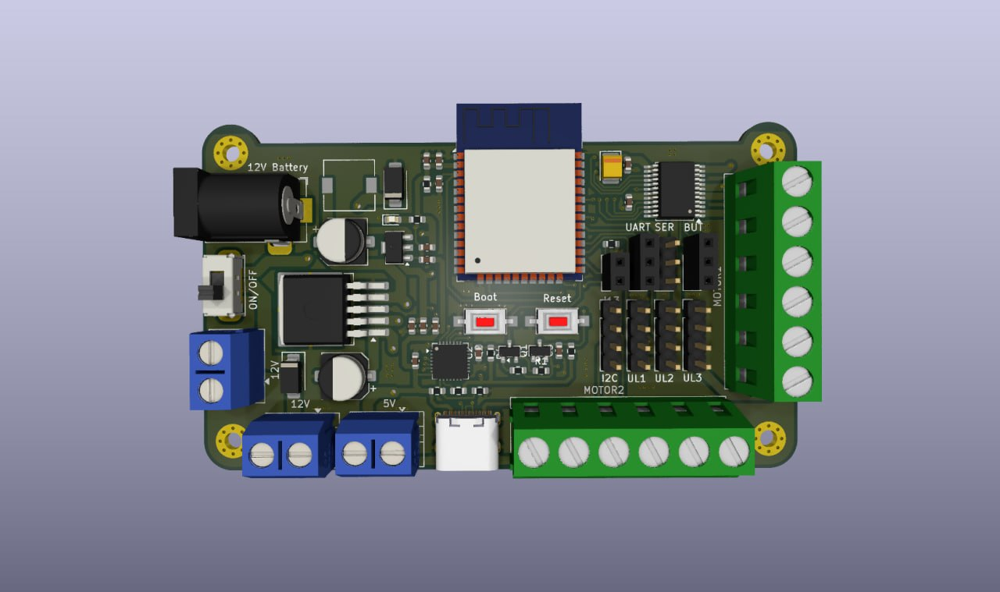

# Electrical system — International robot

This folder documents the electrical system of the rebuilt IriSight robot used
for the WRO 2026 International Final: power distribution, signal wiring,
component connections, pin assignments and a datasheet-based power budget.

The robot uses two separate 3S LiPo batteries. **Battery A** powers the main
controller (NVIDIA Jetson Orin Nano), which in turn powers its USB camera and
I2C sensors. **Battery B** powers the actuators and the LiDAR through two
step-down converters. The Jetson sends steering and speed commands over USB to
a custom ESP32 control board, which drives the motor and the steering servo.

| File | Contents |
| --- | --- |
| [`power_distribution_diagram.png`](power_distribution_diagram.png) ([PDF](power_distribution_diagram.pdf)) | Batteries, converters and every powered component |
| [`signal_wiring_diagram.png`](signal_wiring_diagram.png) ([PDF](signal_wiring_diagram.pdf)) | Data and control connections between all components |
| [`PCBESP32.jpeg`](PCBESP32.jpeg) | 3D render of the custom ESP32 control board design |

## Power distribution



- **Battery A → main controller.** Battery A connects through an XT60
  connector and an XT60-to-barrel lead directly to the Jetson's DC barrel jack.
  The Jetson runs in its 15 W power mode and starts as soon as the battery is
  connected. It supplies the USB camera (USB 5 V) and the two I2C sensors (40-pin
  header power pins).
- **Battery B → actuators and LiDAR.** Battery B connects through an XT60
  connector and a power button to two step-down converters:
  - an **XL4016** converter set to about 11 V feeds the ESP32 control board
    (board logic and motor driver) and the Hokuyo LiDAR;
  - an **XL4015** converter set to 5 V feeds the MG996R steering servo.
- **Why two batteries.** The two-battery layout was kept from the National
  robot, where it was chosen so that current surges from the motor and servo
  do not disturb the Jetson's supply.
- **Shared ground.** A USB cable carries a ground wire, so the USB link between
  the Jetson and the ESP32 board also joins the grounds of the two battery
  sides. The supplies are separate, but the system shares a common ground.

## Signal and data wiring



### Main controller (Jetson) connections

The addresses, bus numbers and device names below are those configured in the
control software.

| Device | Jetson port | Setting |
| --- | --- | --- |
| Hokuyo UST-30LX LiDAR | Ethernet | LiDAR at `192.168.0.10`, port `10940`; the Jetson's Ethernet port uses a fixed IP address |
| ESP32 control board | USB | Serial device `/dev/ttyUSB0`, 115200 baud |
| 1 MP USB camera | USB | Video device 0 (V4L2) |
| BNO055 IMU | 40-pin header, I2C | Bus 7, address `0x28` |
| VL53L0X distance sensor | 40-pin header, I2C | Bus 1, address `0x29` |

On recent JetPack releases, I2C bus 7 is on header pins 3 (SDA) and 5 (SCL),
and bus 1 is on pins 27 (SDA) and 28 (SCL). The physical pins and the 3.3 V or
5 V supply pin used for each sensor on this robot are still to be confirmed.

### ESP32 control board pin assignments

From [`src/microcontroller/firmware/firmware.ino`](../src/microcontroller/firmware/firmware.ino):

| Function | ESP32 pin | Details |
| --- | --- | --- |
| Steering servo signal | GPIO 18 | 50 Hz servo signal; firmware limits 35–150, centre (straight ahead) 95 |
| Motor direction 1 (`MOTOR_IN1`) | GPIO 25 | Motor driver input |
| Motor direction 2 (`MOTOR_IN2`) | GPIO 26 | Motor driver input |
| Motor speed | GPIO 33 | PWM, 20 kHz, 8-bit (0–255) |
| Jetson link | USB | Serial, 115200 baud, newline-terminated commands |
| Start button | Wired to the board | Input pin not yet documented |

Main serial commands from the Jetson:

```text
DRIVE <steering-offset> <speed 0-255>   forward with steering
BACK  <steering-offset> <speed 0-255>   reverse with steering
STOP                                    stop the motor and centre the steering
```

The firmware replies with `OK …` after each accepted command. Higher servo
values steer right; from the centre value the firmware allows +55 to the right
and −60 to the left.

## Components

| Component | Model | Role | Connection | Powered from |
| --- | --- | --- | --- | --- |
| Main controller | NVIDIA Jetson Orin Nano (developer kit carrier board) | Perception, navigation, lap counting, parking | — | Battery A, barrel jack |
| Control board | Custom ESP32 board | Motor and steering control | USB serial to Jetson | XL4016 output |
| Motor driver | TB6612FNG | Drives the rear motor | ESP32 GPIO 25 / 26 / 33 | XL4016 output |
| Drive motor | JGB37-520 geared DC motor, 12 V version | Rear drive through the differential | Motor driver | XL4016 output, through the driver |
| Steering servo | MG996R | Ackermann front steering | ESP32 GPIO 18 | XL4015 (5 V) |
| LiDAR | Hokuyo UST-30LX | 2D range scan for wall and obstacle distances | Ethernet | XL4016 output |
| Camera | 1 MP USB camera from the Yahboom Raspbot V2 kit | Vision for the Obstacle Challenge | USB | Jetson USB |
| IMU | Adafruit BNO055 breakout | Heading and lap counting | I2C bus 7 | Jetson header |
| Rear distance sensor | VL53L0X time-of-flight breakout | Rear distance during parking | I2C bus 1 | Jetson header |
| Start button | Push button | Start input | ESP32 board | ESP32 board |
| Batteries | 2 × TCB 3S LiPo, 1100 mAh, 25C | A: main controller; B: actuators and LiDAR | XT60 | — |
| Converters | XL4016 (≈ 11 V) and XL4015 (5 V), step-down | Battery B supply rails | — | Battery B |

## Sensor selection, placement and calibration

| Sensor | Why it was selected | Placement and field-geometry reason | Calibration or verification method |
| --- | --- | --- | --- |
| Hokuyo UST-30LX | Direct 2D range data replaced the National RealSense D455 after its left-side readings became noisy | Forward-facing at the front. Its 270° scan covers the front, front corners and both side walls used for wall following and pillar manoeuvre timing. The cantilevered mount keeps the complete robot inside the 300 mm length limit. | Place a flat target at known front and side distances, compare the physical distance with the median LiDAR sectors, and check sector boundaries three times ([`SENS-01`](../other/testing/procedures.md#sens-01--lidar-distance-and-sector-check)). |
| 1 MP USB camera | Small color camera is sufficient for red/green classification while LiDAR handles distance | Pans at the front so the planned stationary parking-lot scan can observe left, center and right regions before motion. Keeping the scan stationary reduces vibration and pose-change errors. | Use a target at a known bearing to calibrate field of view and yaw offset; for mapping, compare all eight generated assignments with the known layout under multiple lighting conditions ([`MAP-01`](../other/testing/procedures.md#map-01--stationary-three-angle-pillar-map)). |
| BNO055 | Provides heading for turn completion and lap counting independently of wheel slip | Fixed to the chassis so its yaw follows the complete robot. It complements LiDAR distance with orientation. | Zero at the start pose; physically rotate through 90°, 180°, 270° and back to 0° three times, recording error and final drift ([`SENS-02`](../other/testing/procedures.md#sens-02--imu-heading-check)). |
| Rear VL53L0X | Covers the rear blind spot of the forward LiDAR during reverse parking | Centered and rear-facing on the Jetson-support platform so the parking wall is measured along the reverse path | Compare physical and reported rear distances around the steering-switch and stop thresholds, including with motor and servo active ([`SENS-03`](../other/testing/procedures.md#sens-03--rear-tof-parking-distance-check)). |

Selection and placement were refined from observed failures: the RealSense was
replaced after noisy left-side sensing; the rear ToF was added because the
front LiDAR cannot see directly behind the vehicle; the USB cable was replaced
after repeated camera disconnections; and the LiDAR guard was retained after
protecting the scanner during multiple contacts without blocking its scan.
Calibration procedures are documented even where final numerical results are
still pending, so missing measurements are not replaced with assumed values.

### Custom ESP32 control board



The render of the board design shows a "12V Battery" barrel power input, an
ON/OFF slide switch, 12 V and 5 V screw terminals, a USB-C connector, Boot and
Reset buttons, pin headers labelled UART, SER, BUT, I2C, UL1, UL2 and UL3, and
two 6-way screw terminals labelled MOTOR1 and MOTOR2. The 6-way terminals match
the six-wire encoder motor (motor +, motor −, two encoder signals, encoder
supply and ground). The current firmware does not read the encoder.

## Power budget (datasheet-based)

The values below come from manufacturer datasheets and product listings. They
are **not measurements** from this robot. Converter losses are not included,
and the actual draw while driving is expected to be lower than the
rated-load and stall cases.

### Battery A — main controller side (3S, connected directly)

| Load | Datasheet or rated figure | Power |
| --- | --- | ---: |
| Jetson Orin Nano | 15 W power mode (power budget) | 15 W |
| 1 MP USB camera | Not published; USB 2.0 port limit 0.5 A at 5 V | ≤ 2.5 W |
| BNO055 IMU | 12.3 mA maximum in normal (fusion) mode | ≈ 0.04 W |
| VL53L0X | 19 mA average while ranging, 40 mA peak | ≈ 0.06 W |
| **Upper estimate** | | **≈ 17.6 W ≈ 1.6 A at 11.1 V** |

One 1100 mAh 3S battery stores about 12.2 Wh (1.1 Ah × 11.1 V nominal). At
the upper estimate this would last about 42 minutes. From experience the team
estimates about 1–2 hours; if that is correct, the average draw is well below
the 15 W budget. A measured runtime has not yet been recorded.

### Battery B — actuator side (through the converters)

| Load | Rail | Datasheet figure | Power at the rail |
| --- | --- | --- | ---: |
| JGB37-520 motor | ≈ 11 V | 12 V versions: 0.12 A no load, 1 A at rated load, 2.3 A stall | 1.3 W / 11 W / 25.3 W |
| Hokuyo UST-30LX | ≈ 11 V | 3.6 W steady (≤ 150 mA at 24 V); 450 mA during start-up | 3.6 W |
| ESP32 module | 3.3 V on the board | About 30–68 mA with the radio off | ≈ 0.1–0.2 W |
| MG996R servo | 5 V | 0.5–0.9 A running, 2.5 A stall (at 6 V) | 2.5–4.5 W; ≤ 12.5 W stall |

| Case | Total | Battery current at 11.1 V |
| --- | ---: | ---: |
| Rated load (motor at rated load, servo running, LiDAR, ESP32) | ≈ 19 W | ≈ 1.7 A |
| Worst case (motor and servo both stalled, LiDAR, ESP32) | ≈ 42 W | ≈ 3.8 A |

### Headroom checks

| Part | Requirement from the budget | Rating | Result |
| --- | --- | --- | --- |
| Battery (25C, 1.1 Ah) | ≈ 3.8 A worst case (≈ 3.4C) | 27.5 A theoretical continuous | Large margin |
| XL4016 output | ≈ 1.4 A rated load; ≈ 2.7 A worst case | 8 A (XLSEMI datasheet; a later revision lists 12 A) | Large margin |
| XL4015 output | Up to 2.5 A (servo stall) | 5 A | 2× margin |
| Motor driver channel | 1 A at rated load; 2.3 A at stall | TB6612FNG: 1.2 A average, 3.2 A peak (short pulse only) | Rated load fits; a sustained stall exceeds the continuous rating |

### Voltage-range checks

| Part | Supply on the robot | Allowed range | Note |
| --- | --- | --- | --- |
| Battery (3S LiPo) | — | 9.0 V (empty, 3.0 V/cell) to 12.6 V (full, 4.2 V/cell) | — |
| Jetson DC jack | 9.0–12.6 V (battery directly) | 9–20 V (carrier board specification, as quoted by NVIDIA's forum) | Close to the minimum when the battery is nearly empty |
| Hokuyo UST-30LX | ≈ 11 V | 10–30 V | About 1 V above the minimum |
| MG996R | 5 V | 4.8–7.2 V (some sources 4.8–6.6 V) | Within range |
| TB6612FNG motor supply | ≈ 11 V | Up to 13.5 V recommended, 15 V absolute maximum | Within range |
| XL4015 / XL4016 input | 9.0–12.6 V | 8–36 V / 8–40 V | Within range |

**Design note — step-down converter on the ≈ 11 V rail.** The XL4016 is a
step-down (buck) regulator. It can hold its ≈ 11 V output only while Battery B
stays above that voltage plus the converter's dropout. A 3S pack is 11.1 V
nominal, so for part of the discharge the rail follows the battery downward.
This lowers motor speed for a given PWM value and reduces the LiDAR's margin
above its 10 V minimum.

## Reliability findings

- **Camera disconnections.** The USB camera often disconnected. The team
  replaced the camera cable several times until the connection became stable.
- **IMU disconnections.** The BNO055 occasionally disconnects. The sensors are
  connected to the Jetson header with single-pin jumper wires; the cause has
  not yet been identified.
- **Battery swelling.** Several LiPo packs swelled and could no longer be
  charged. Swollen LiPo packs are a fire risk.

## Known limitations

- The firmware has no command timeout: if commands from the Jetson stop, the
  motor keeps its last command.
- Neither battery path has a fuse.
- The motor encoder is not used by the current firmware.

## Verification status

| Item | Status |
| --- | --- |
| Components, battery assignment, Jetson port use | Confirmed by the team |
| ESP32 pin assignments | From the tested firmware |
| Battery B wiring layout (button and converter connections) | Described by the team; not yet traced on the robot |
| Converter output voltages (≈ 11 V, 5 V) | Set points from the previous build; not yet re-measured |
| I2C bus numbers, addresses, LiDAR IP | From the control-software configuration |
| Header pin numbers and sensor supply pins | Not yet confirmed |
| Power budget | Datasheet values; not measured |
| Battery runtime | Team experience about 1–2 hours; not measured |

## Previous version

The National-stage electrical diagrams, component photos and editable Draw.io
source are preserved in
[`other/legacy_national/schemes/`](../other/legacy_national/schemes/) as
development history. They describe the earlier robot and must not be used to
wire the current one.

## Datasheet sources

- JGB37-520 motor: manufacturer datasheet supplied by the team
- Hokuyo UST-30LX: [data sheet](https://cdn.robotshop.com/media/H/Hok/RB-Hok-43/pdf/hokuyo_ust_30lx_scanning_laser_rangefinder_data_sheet.pdf),
  [Clearpath summary](https://docs.clearpathrobotics.com/docs_robots/accessories/sensors/lidar_2d/hokuyo_ust30_lx)
- MG996R: [TowerPro datasheet copy](https://people.ece.cornell.edu/land/courses/ece4760/FinalProjects/f2017/kmv48_rp625/kmv48_rp625/kmv48_rp625/MG996RTowerPro.pdf)
- XL4016: [XLSEMI datasheet](https://datasheetspdf.com/pdf/839856/Xlsemi/XL4016/1);
  XL4015: [XLSEMI datasheet](https://handsontec.com/dataspecs/IC/XL4015.pdf)
- TB6612FNG: [Toshiba datasheet](https://toshiba.semicon-storage.com/info/docget.jsp?did=10660)
- Jetson Orin Nano Developer Kit: [NVIDIA getting-started guide](https://developer.nvidia.com/embedded/learn/get-started-jetson-orin-nano-devkit),
  [DC input range discussion](https://forums.developer.nvidia.com/t/jetson-orin-nano-input-voltage/298625),
  [I2C bus numbering](https://forums.developer.nvidia.com/t/i2c-bus-number-changed-unexpectedly-on-jetson-orin-nano/326222)
- BNO055: [Bosch Sensortec community (datasheet figure)](https://community.bosch-sensortec.com/t5/MEMS-sensors-forum/BNO055-what-is-current-consumption-in-worst-case-mode/m-p/66783)
- VL53L0X: [ST product page](https://www.st.com/en/imaging-and-photonics-solutions/vl53l0x.html)
- ESP32: [current-consumption summary of Espressif figures](https://jlcpcb.com/blog/esp32-power-consumption-explained)
- 1 MP USB camera: [Yahboom product listing](https://robotshop.com/products/yahboom-usb-camera-module-raspberry-pi-jetson-1mp-usb-camera)
