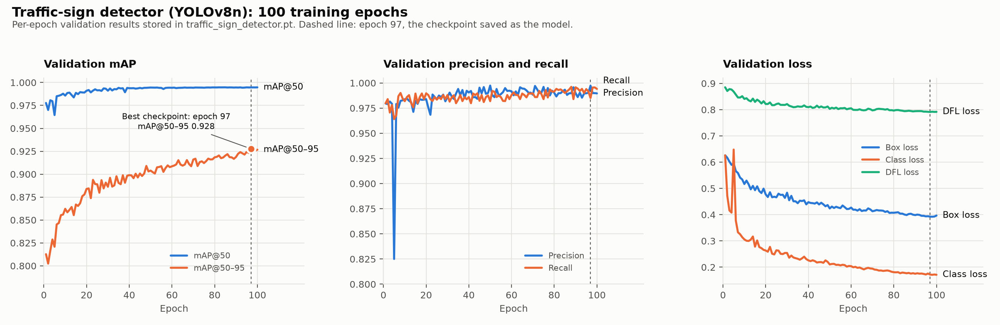

# 🤖 AI Model — Traffic-Sign Detector

The robot uses one object-detection model to tell red and green traffic signs (pillars) apart in the Obstacle Challenge. The camera only says **which colour a pillar is and in which direction it lies**; the LiDAR measures the distance.

## 📦 Overview

| | |
|---|---|
| **Framework** | [Ultralytics YOLOv8](https://docs.ultralytics.com/) (version 8.3.158) |
| **Base architecture** | YOLOv8n (nano), started from the pretrained `yolov8n.pt` |
| **Weights file** | `traffic_sign_detector.pt` |
| **Input size** | 640 × 640 |
| **Classes** | 3 — `greenbox`, `redbox`, `xparking` |
| **Training epochs** | 100 |
| **Batch size** | 8 |
| **Optimizer** | `auto` — the stored learning-rate log peaks at 0.0014, the value Ultralytics' automatic setting gives AdamW for a 3-class model |
| **Training time** | 8,018 s (about 2 h 14 min) |
| **Saved checkpoint** | Epoch 97, the epoch with the best validation score |
| **Trained** | 25 June 2026, for the National robot |
| **Runs on** | NVIDIA Jetson Orin Nano (onboard, real time) |

YOLOv8n is the smallest YOLOv8 model. It was chosen so that detection runs in real time on the Jetson Orin Nano while the LiDAR and control loops run beside it.

> Every value above is read from the checkpoint file itself, except the training date, which the team confirmed.

## 🗂️ Files

```text
ai_model/
├── traffic_sign_detector.pt     # Trained YOLOv8n model (Ultralytics checkpoint)
├── results/
│   ├── training_curves.png      # Validation metrics and losses for all 100 epochs
│   └── training_results.csv     # The same per-epoch numbers as a table
└── photos/
    └── red_detect.png           # Example detection of a red pillar
```

`traffic_sign_detector.pt` is a full Ultralytics checkpoint (not just raw weights) — it also stores the class names, training args, EMA weights, and training metrics, so it is self-describing and can be loaded directly without a separate `data.yaml`.

## 🎯 What the Model Detects

| Class ID | Label | Meaning | Used by the robot? |
|----------|-------|---------|--------------------|
| `0` | `greenbox` | Green obstacle pillar | ✅ Pass on the **left** side |
| `1` | `redbox` | Red obstacle pillar | ✅ Pass on the **right** side |
| `2` | `xparking` | Parking lot marker | ❌ Not used by the current programs — parking uses the rear VL53L0X sensor |

Under rule 9.19, the robot must pass a **red** pillar on its **right** and a **green** pillar on its **left**. Which side to pass is decided from the pillar map, as described in the Obstacle Challenge README.

## 🏋️ Training Details

- **Hardware:** trained on a CUDA GPU with mixed precision.
- **Labeling format:** YOLO bounding boxes around each pillar or parking marker.
- **Augmentation:** colour jitter (hue 0.015, saturation 0.7, brightness 0.4), shift 0.1, scale 0.5, left-right flip 0.5, mosaic (turned off for the last 10 epochs), RandAugment, and random erasing 0.4.

### 🗃️ Dataset

The labelled dataset is public on [Roboflow Universe](https://universe.roboflow.com/damian-igwmf/wro-detection-47xs2-ahmqb), where the project holds 5,022 images. No public dataset version is currently generated, so the exact training, validation and test split used for the original local training run could not be independently recovered.

The dataset was built with a semi-supervised workflow:

1. About 300 images were labelled by hand in CVAT.
2. The first trained model labelled more images automatically.
3. Those labels were checked and corrected by hand in CVAT.
4. The corrected images were added to the training set and the model was trained again.

### 📊 Validation Performance

These are the checkpoint's stored validation results at epoch 97:

| Metric | Value |
|--------|------:|
| Precision | 0.997 |
| Recall | 0.985 |
| mAP@50 | 0.995 |
| mAP@50–95 | 0.928 |
| Box loss | 0.393 |
| Class loss | 0.172 |
| DFL loss | 0.791 |



mAP@50–95 rose from 0.81 after the first epoch to 0.93. All three validation losses reached their lowest values at epochs 97–98, so the model was still improving slowly at the end of training rather than over-fitting. The full table is in [`results/training_results.csv`](results/training_results.csv).

## ⚙️ Installation

Install NVIDIA's JetPack build of PyTorch on the Jetson first, then `ultralytics` without letting it replace that PyTorch build:

```bash
pip install ultralytics --no-deps
pip install opencv-python pyyaml pillow
```

On a normal PC, `pip install ultralytics` is enough.

## ▶️ How to Use It

### 1. Quick test — run inference on an image or folder

Use the same confidence as the robot:

```bash
yolo detect predict model=traffic_sign_detector.pt source=path/to/images conf=0.65
```

Annotated output images are saved under `runs/detect/predict/`.

### 2. Run inference from Python

```python
from ultralytics import YOLO

model = YOLO("traffic_sign_detector.pt")
for box in model("test_image.jpg", conf=0.65)[0].boxes:
    label = model.names[int(box.cls[0])]       # greenbox / redbox / xparking
    print(label, round(float(box.conf[0]), 2), box.xyxy[0].tolist())
```

### 3. Useful inference parameters

| Parameter | Purpose | Typical value on our robot |
|-----------|---------|----------------------------|
| `conf` | Minimum confidence to keep a detection | `0.65` (`CAMERA_CONFIDENCE`) |
| `iou` | NMS IoU threshold for overlapping boxes | `0.45` (default) |
| `imgsz` | Inference resolution | `640` (matches training size) |

The obstacle programs load the model from the folder they are run in; see [`../main_controller/obstacle_challenge/`](../main_controller/obstacle_challenge/) for the run commands.

## 🔗 How the Robot Uses It

The two Obstacle Challenge programs in [`../main_controller/obstacle_challenge/`](../main_controller/obstacle_challenge/) run the model in their own camera thread:

1. **Camera in →** the 1 MP USB camera (video device 0) delivers frames 640 px wide.
2. **Filtering →** the model keeps detections with a confidence of at least 0.65 (`CAMERA_CONFIDENCE`). Only `redbox` and `greenbox` are used.
3. **Direction →** the horizontal position of each box is turned into a direction relative to the LiDAR, using the camera's field of view (`CAMERA_FOV_DEG = 70`) and mounting angle (`CAMERA_YAW_OFFSET_DEG = 0`), as set in the programs.
4. **LiDAR fusion →** when a detection lines up with a LiDAR sector, the controller treats that reading as a pillar, not a wall. Detections older than 0.3 s are ignored.
5. **Safety →** every emergency stop uses the raw LiDAR distances, never the camera.

The model runs unchanged on the International robot with its 1 MP USB camera. The example photo in [`photos/red_detect.png`](photos/red_detect.png) was recorded with the National robot's camera.

## ⚠️ Limitations & Notes

- The model does not track objects across frames (no built-in tracker); old detections are discarded by the 0.3 s age limit in the controller.
- The camera gives colour and direction only — distance always comes from the LiDAR.
- `xparking` is part of the model's label set but is not used by the current programs.
- The exact dataset split of the original training run could not be recovered (see Dataset above).

## 📜 Version History

| Date | File | Change | Why we changed it |
|------|------|--------|-------------------|
| 25 June 2026 | `best1.pt` | YOLOv8n trained for 100 epochs on the team's pillar dataset | Detect red and green traffic signs and the parking marker on the National robot |
| 23 November 2026 | `traffic_sign_detector.pt` | Same model, renamed; the weights are unchanged | A name that says what the model does. The National copy keeps its old name in [`other/legacy_national/`](../../other/legacy_national/) |
