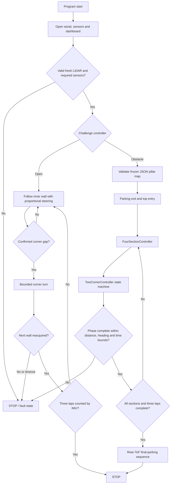

# Jetson main controller

The NVIDIA Jetson Orin Nano reads the sensors, decides steering and speed, and
sends commands to the ESP32 board over USB serial. Every program is a single
Python file, and its settings are listed at the top of the file.

| Path | Contents |
| --- | --- |
| [`open_challenge/`](open_challenge/) | `open_clockwise.py`, `open_counter_clockwise.py`: LiDAR wall following with IMU lap counting |
| [`obstacle_challenge/`](obstacle_challenge/) | `obstacle_clockwise.py`, `obstacle_counter_clockwise.py`: pillar-map run with camera, parking exit and final parking |
| [`config/`](config/) | Pillar map JSON files read by the obstacle programs |
| [`sensors/`](sensors/) | Where each sensor's code is in the programs, and its calibration status |
| [`requirements.txt`](requirements.txt) | Python packages imported by the programs |

The driving direction is chosen by running the clockwise or counter-clockwise
file.

Current validation status reported by the team on November 23, 2026:

- Open Challenge clockwise and counter-clockwise have both been tested on the
  rebuilt robot;
- Obstacle Challenge counter-clockwise is the active test baseline and is
  progressively improving; and
- Obstacle Challenge clockwise uses the same direction-aware mirrored
  architecture; final direction-specific regression records remain pending.

## Software design (shared by all programs)

- **Three threads:** a LiDAR thread, a control thread and a Flask web server.
  They share data under a lock.
- **Fail-safe stops:** the program sends `STOP` if the LiDAR data is older than
  `SCAN_TIMEOUT` (0.5 s), if a needed front or side reading is missing, if a
  manoeuvre takes longer than its time limit, and when the program exits.
- **Median sampling:** each distance is the median of the LiDAR readings inside an
  angle sector, not a single ray, to reject noise. Angles use the convention
  **+90° = left, 0° = front, −90° = right**.
- **Web dashboard (testing only):** `http://<jetson-ip>:5000` shows the LiDAR
  scan, distances, the command being sent, steering, PWM, yaw and lap count. The
  obstacle programs also stream the annotated camera view at `/camera`. A JSON
  feed is at `/scan`.

## Control-state flow and rationale



The Open controller stays intentionally small because the empty track requires
only wall-error correction, corner confirmation and lap counting. The Obstacle
controller uses explicit phases because each pillar-color order requires a
bounded sequence of approach, steering, heading recovery and section handoff.
Both designs fail to `STOP` when required sensor data is missing or stale, a
phase exceeds its timeout, or a required reading cannot be validated.

## Tuning and validation metrics

| Area | Values adjusted or observed | Metrics used to judge it |
| --- | --- | --- |
| Open wall following | 0.35 m target, proportional gain, ±29° steering limit, straight/corner PWM | Wall error, contacts, corner completion, lap count, completion time and autonomous stop |
| Corner detection | 0.80 m opening, two confirming scans, 2 s turn timeout | False corner count, missed corners, wall reacquisition and timeout faults |
| Obstacle manoeuvres | Per-phase distance triggers, steering, PWM, heading tolerance and timeout | Correct passing side, contacts, completed sections/laps, heading error and fault state |
| Camera/LiDAR fusion | Detection confidence, field of view, yaw offset and 0.3 s maximum detection age | Pillar classification, bearing agreement, stale detections and raw-LiDAR emergency stops |
| Parking | Rear-distance steering-switch and stop thresholds | Parking success, final clearance, contact, elapsed time and autonomous stop |

The tuning process changes one documented value after a recorded failure, then
repeats the same procedure. [`other/testing/procedures.md`](../../other/testing/procedures.md)
defines the measurements and acceptance conditions; the
[`video evidence register`](../../other/testing/video_evidence_register.md)
separates historical demonstrations from final-configuration trials.

## Setup

**Hardware:**

- the Hokuyo LiDAR on Ethernet, with the Jetson's Ethernet port given a fixed
  address on the `192.168.0.x` network;
- the ESP32 board and the USB camera on USB;
- the BNO055 on I2C bus 7 and the rear VL53L0X on I2C bus 1.

Wiring is in [`../../schemes/`](../../schemes/).

**Python packages:**

```bash
pip install -r requirements.txt
```

On the Jetson, install NVIDIA's JetPack build of PyTorch **before**
`ultralytics`. See [`../ai_model/README.md`](../ai_model/README.md).

**Hardware settings** are at the top of each program: `LIDAR_IP`, `ESP32_PORT`,
`IMU_BUS`, `CAMERA_INDEX` and `WEB_PORT`.

## Running

Open Challenge (from this folder):

```bash
python3 open_challenge/open_clockwise.py          # or open_counter_clockwise.py
```

Obstacle Challenge: run it from `obstacle_challenge/`, because the program
loads `traffic_sign_detector.pt` from the folder it is run in (`CAMERA_MODEL_PATH`). A link
avoids keeping a second copy of the model:

```bash
cd obstacle_challenge
ln -s ../../ai_model/traffic_sign_detector.pt traffic_sign_detector.pt
python3 obstacle_counter_clockwise.py ../config/wro_pillar_0_270_180_90.json
python3 obstacle_clockwise.py ../config/pillar_clockwise.json
```

Press `Ctrl+C` to stop. The program then sends `STOP` to the ESP32.

## Safety

- **Test with the wheels lifted** before enabling the motors, and check the
  steering direction and sensor angles first.
- The programs assume the ESP32 stops the motor when commands stop arriving.
  **The current firmware has no such timeout**, so if the program or USB link
  fails, the motor keeps its last command.
- Corner timings and wall distances in the code are approximate and depend on the
  field. Re-tune them on the actual track.

## Not implemented yet

- **Start button:** the programs start driving straight away. They do not yet
  wait for the single start button required by General Rules 9.10–9.11.
- **Starting without a laptop:** the programs are currently started over SSH. At
  competition, wireless must be off (rule 11.10), so the robot must launch the
  program by itself at power-on.
- **Automatic pillar scan:** the planned design pans the stationary camera to
  three calibrated angles, merges YOLO detections and writes the validated JSON
  map before driving. The current repository contains the map consumer but not
  the camera-servo control or map generator (see
  [`obstacle_challenge/`](obstacle_challenge/)).
- **Shared code:** the sensor, serial and dashboard code is repeated inside each
  program and has not yet been moved into shared modules.

## Legacy code

The National Round programs (RealSense depth camera and ultrasonic sensors) are
archived in
[`../../other/legacy_national/src/`](../../other/legacy_national/src/) and must
not be used on the rebuilt robot.
