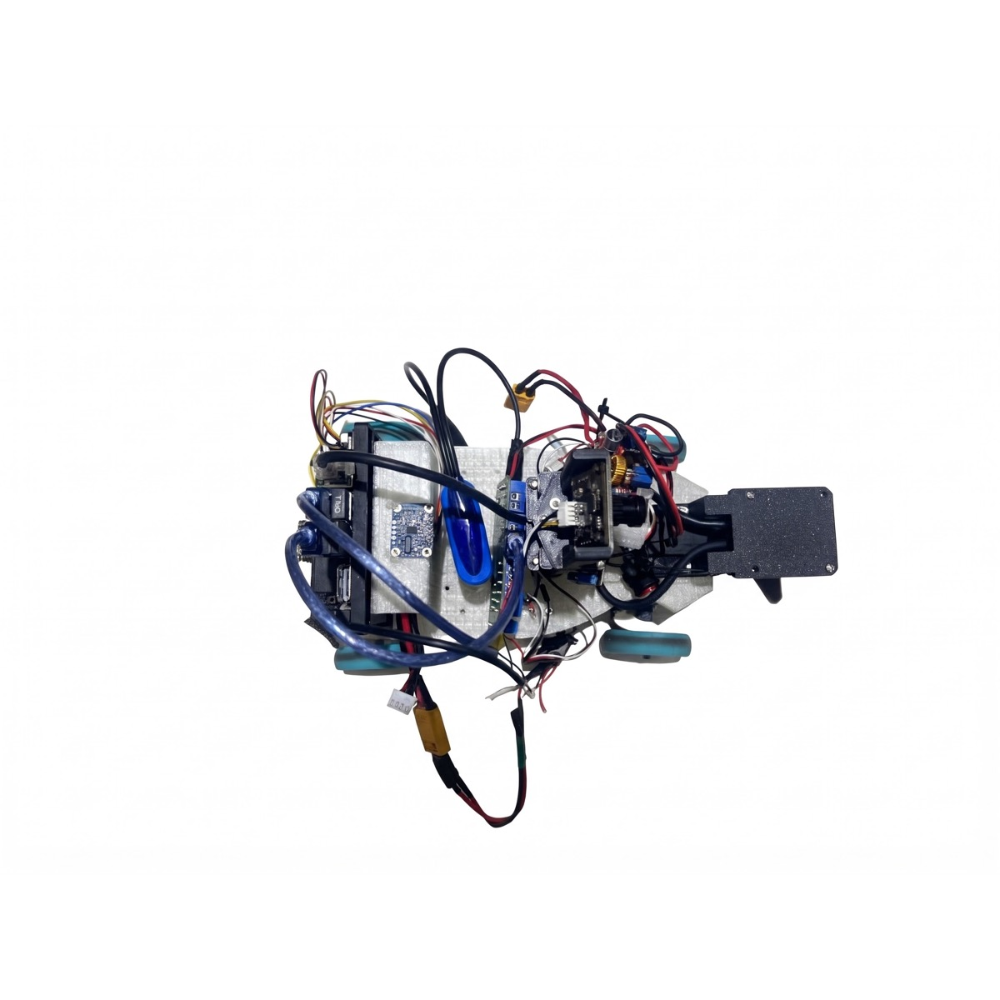
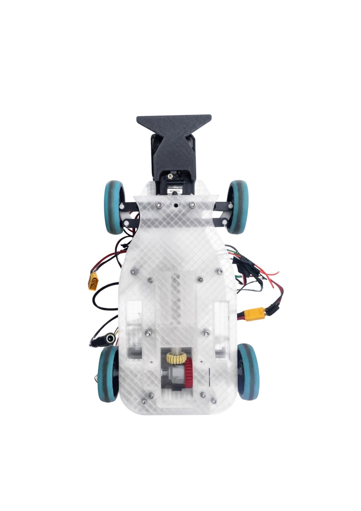
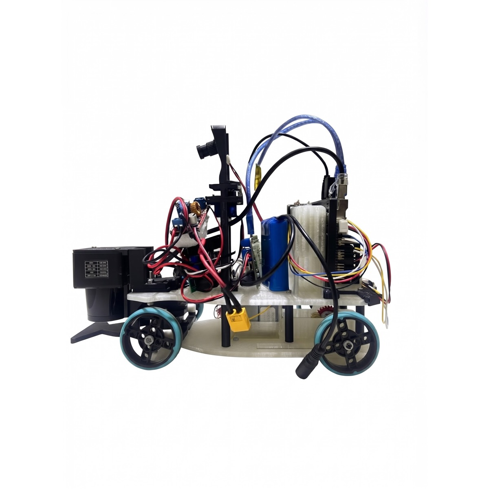
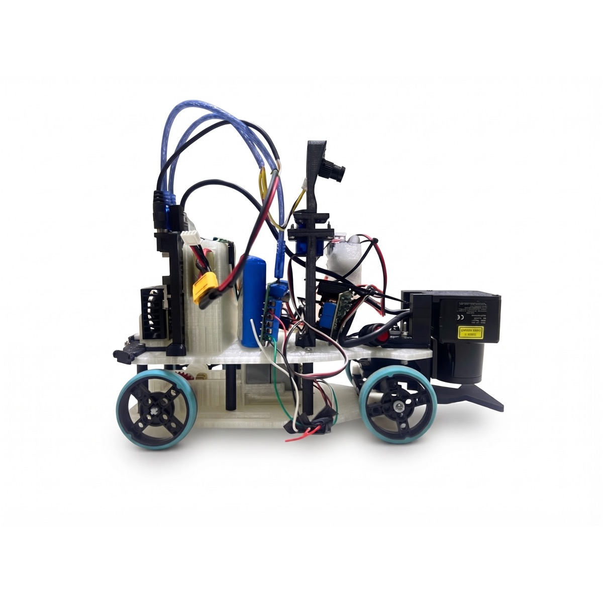
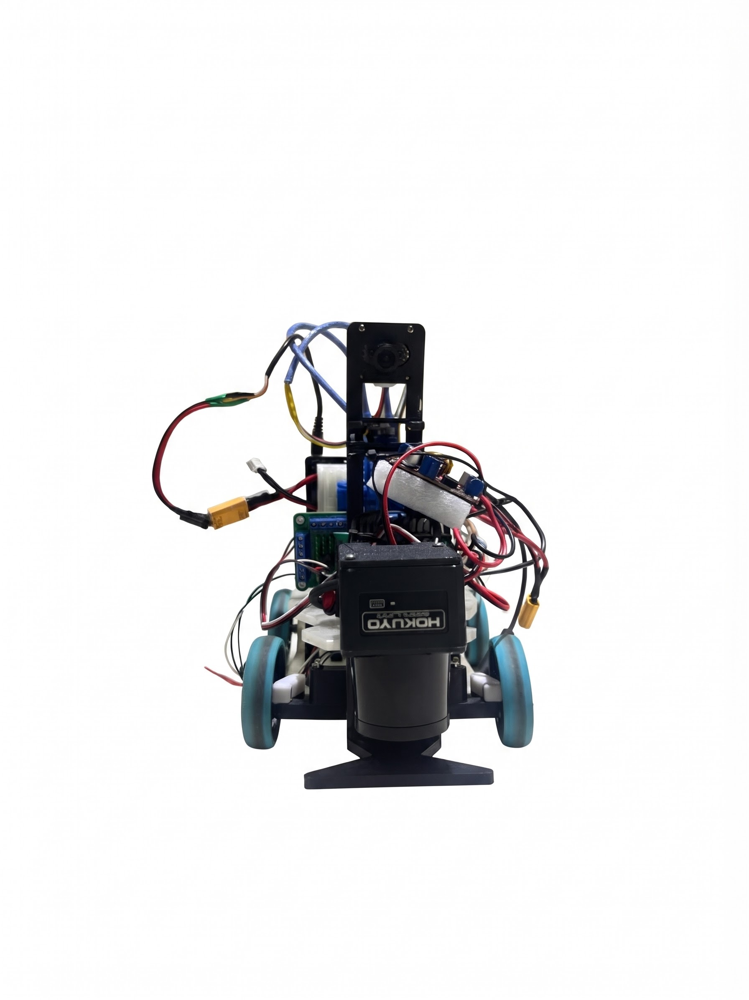
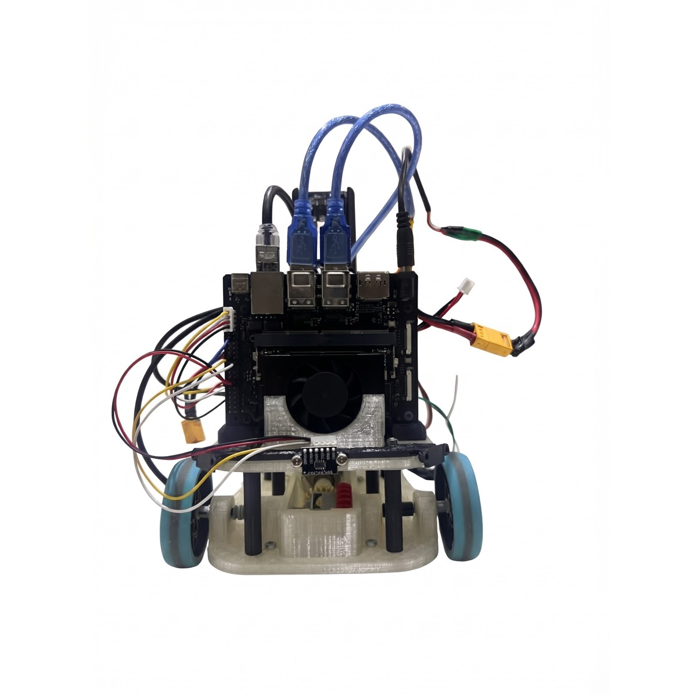

Vehicle's photos
====
This folder contains a complete photo gallery of our robot, capturing it from different angles and highlighting its design, structure, and build quality. From the overall appearance to the smaller details, these photos give you a closer look at how our robot is built and how all its components come together.

|  |  |
| :---: | :---: |
| **Top** | **Bottom** |

|  |  |
| :---: | :---: |
| **Left** | **Right** |

|  |  |
| :---: | :---: |
| **Front** | **Back** |

